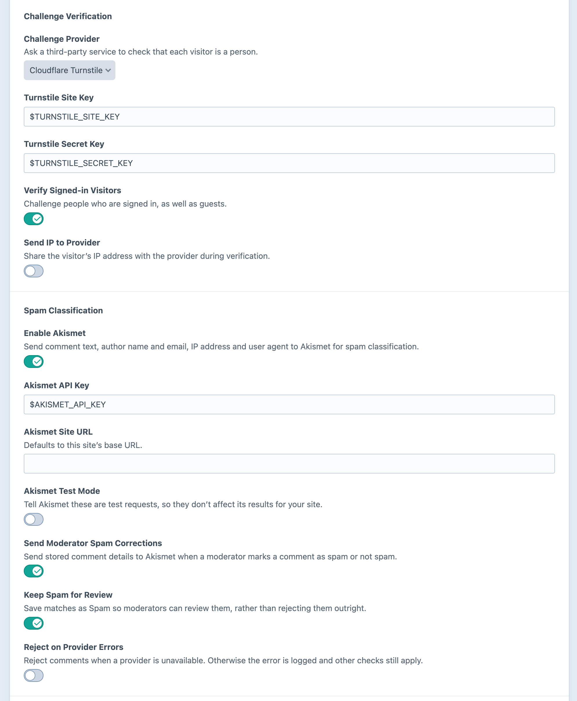
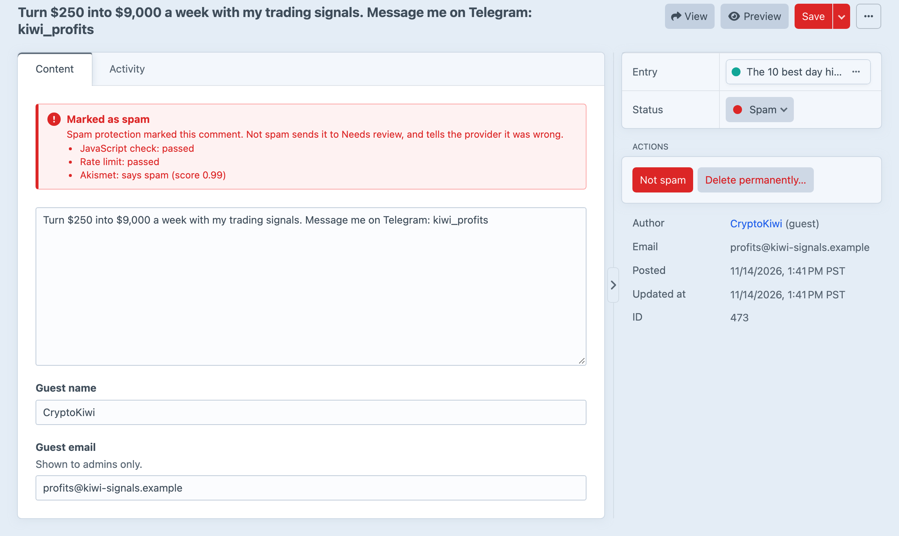

# Anti-Spam

Comments checks public comments before saving them, using the bundled Protect module. Configure it under **Comments** → **Spam Protection**, where **Enable Protection**, which is on by default, turns on the passive checks, comment attempt limits, challenges and spam classifiers described below. Control panel edits, imports and element resaves aren't checked, because they don't come from a public form.

These settings are kept in each environment's database rather than project config, so they can be changed on a live site where admin changes are turned off. Admins can open **Spam Protection** on any environment, and so can anyone with the **Manage spam settings** permission. Each environment keeps its own, so enter your provider keys on each one, or use environment variables. Only admins can enter an environment variable or alias for a key. Someone with only **Manage spam settings** enters keys directly, or keeps one an admin has set. A setting in `config/comments.php` still wins over what's saved, and the page notes when it does. A secret key typed in directly is hidden once it's saved. Leave the hidden value as it is to keep the key, or type a new one to replace it.

The thread from `craft.comments.render()` handles everything these checks need, so your templates need nothing extra. If you write your own forms, see [Displaying & Protecting Comments](docs:template-guides/displaying-protecting-comments). To match comments against your own words and addresses, see [Security](docs:feature-tour/security).

## Passive Checks

These run on every browser form and don't ask a visitor to do anything. They're on by default.

- **Honeypot** adds a hidden field that people leave empty and bots tend to fill in.
- **Minimum Form Time** rejects a form posted too soon after it was opened, three seconds by default. Set it to zero to turn the check off.
- **Prevent Replayed Submissions** lets each prepared form be used once. The thread's form gets a fresh one for its next attempt.

## Rate Limits

**Limit Comment Attempts** caps how many times each person can try to post in a period, whether or not they succeed. **Attempts per Window** sets how many attempts they get, five by default, and **Rate Window** sets the period in seconds, 60 by default. **Minimum Time Between Comments** adds a wait between comments, which is off until you set it. Signed-in visitors are counted by their user account and guests by IP address. If your site is behind a proxy or CDN, read [Client IP Addresses](docs:feature-tour/security#client-ip-addresses) first, or all your guests will share one limit. A visitor who goes over gets a message to wait, and API responses use HTTP 429 with a `Retry-After` header.

Votes, reports and guest subscriptions have their own fixed limits, which apply even when **Enable Protection** is off:

| Action | Limit for Each Person |
| --- | --- |
| Voting | 60 a minute |
| Reporting | 3 every 10 minutes |
| Guest subscribing | 5 an hour |

Replay protection and rate limits are kept in Craft's cache, so keep the cache shared across web servers, or each one counts separately. Clearing the cache resets them.

## Content Rules

These look at what a comment says and who sent it. They apply whether or not **Enable Protection** is on.

- **Maximum Links** holds a comment for review when it has more links than the number you set, with the reason **Too many links**. Links in a rich comment and web addresses written out in its text both count, starting with `http://`, `https://` or `www.`. It's blank by default, which sets no limit. Comment spam usually carries several links, so a limit of two catches most of it while letting people share a source.
- **Blocked Email Domains** refuses comments from guests whose email address is at one of the domains you list, one per line, such as `example.com`. A domain also covers its subdomains, so `example.com` blocks `mail.example.com` too. The guest sees the same message as for a **Banned Keywords** match.

To hold or refuse comments for particular words, combinations of words, or IP addresses and ranges, use the [Keyword Filters](docs:feature-tour/security#keyword-filters).

## Challenge Providers

A challenge asks a third-party service to check that each visitor is a person. Choose one as the **Challenge Provider** and enter its keys from the provider's dashboard. Environment variables are supported.

| Provider | What Visitors See | Keys |
| --- | --- | --- |
| Cloudflare Turnstile | Usually nothing, with an interactive check when Turnstile needs one. | Site key and secret key |
| reCAPTCHA v3 | Nothing. Each visitor gets a score, which has to reach the **Minimum Score** of 0.5 by default. | Site key and secret key |
| hCaptcha | Nothing, unless hCaptcha asks them to solve a puzzle when they post. | Site key and secret key |
| Friendly Captcha | A small box by the form that solves a puzzle in the background once they start typing. | Site key and API key |

Friendly Captcha's **Region** can send verification to its EU service instead of its global one, if your account includes it. Every provider needs JavaScript to run, so visitors without it can't post while a challenge is on.

**Verify Signed-in Visitors** is on by default, and turning it off limits challenges to guests. **Send IP to Provider** is off by default, and shares the visitor's address with the provider. A challenge is only accepted from the hostname of the site's base URL. If comments are posted from other domains, list the hostnames to accept in the [`protectionHostnames`](docs:get-started/configuration#protectionHostnames) setting, which replaces the site's own hostname, so list that too if comments are also posted from the site. A front end listed under **Allowed Origins** doesn't need adding there, because its own hostname is accepted for comments it posts. If that origin has its own challenge keys, only its hostname is accepted. The action names providers receive are `comments_create` and `comments_edit`.

## Spam Classifiers

A spam classifier reads each comment and says whether it's spam. Choose one as the **Spam Classifier** and enter its key. Each receives details of the comment and the visitor, so check this suits your privacy policy.

| Classifier | What It Receives |
| --- | --- |
| Akismet | The comment text, the author's name and email, and the visitor's IP address, browser and the page they came from |
| CleanTalk | The comment text, the author's name and email, and the visitor's IP address, browser and the page they came from |
| OOPSpam | The comment text, the author's email and the visitor's IP address |

**Akismet Site URL** defaults to the site's base URL, and **Akismet Test Mode** keeps test requests from affecting your results. OOPSpam scores each comment from 0 to 6, and **OOPSpam Spam Score** sets the score that counts as spam, 3 by default. OOPSpam treats private and local IP addresses as suspicious, so expect it to flag comments posted on a local development site.

Comments a classifier finds to be spam are saved with the Spam status for review when **Keep Spam for Review** is on, which is the default. Otherwise they're rejected.

## Reviewing What Spam Protection Found
Comments keeps what spam protection found on each comment it checks, such as the classifier's result or a failed bot check. Open a comment from the index's **Spam** source and the notice at the top of the comment lists those findings, so you can see why it was caught before deciding. A comment held as **Possible spam** under **Needs review** shows them too.

**Not spam** returns a comment to **Needs review**, where you can approve it. [Moderation](docs:feature-tour/moderation#deciding-a-comment) covers the other decisions.

**Send Moderator Spam Corrections** is off by default. It tells Akismet or OOPSpam whenever a moderator marks a comment as spam or not spam, as long as the comment has an IP address stored. CleanTalk can't be told.

## Clearing Out Spam

Spam stays under the **Spam** source until someone deletes it. Set **Delete Spam After** to a number of days to have Comments delete spam that hasn't changed in that time, permanently, when Craft collects garbage. Each run deletes up to 100, so a large backlog clears over several runs. Spam with replies is kept until the replies have gone. It's blank by default, which keeps spam until you delete it.

## When a Check or Provider Fails

A failed check, such as a tripped honeypot or a failed challenge, rejects the comment and asks the visitor to refresh the form and try again. The thread's form keeps what they typed.

A provider being unavailable is treated differently, because it says nothing about the comment. The error is logged and the other checks still apply. Turn on **Reject on Provider Errors** to reject comments in this situation instead, with a message to try again. This only covers providers contacted from the server, not checks made in the browser.

A misconfigured provider, such as a wrong secret key, will keep failing until someone fixes it, so nothing gets published unchecked. Comments are held for moderation, or rejected if **Reject on Provider Errors** is on, and the reason is logged. Settings that can't work are also reported when you save them, such as a challenge on a site with no URL to take a hostname from.

Check that this is all working by posting a comment from a signed-out browser, then looking at its status in the Comments index.
