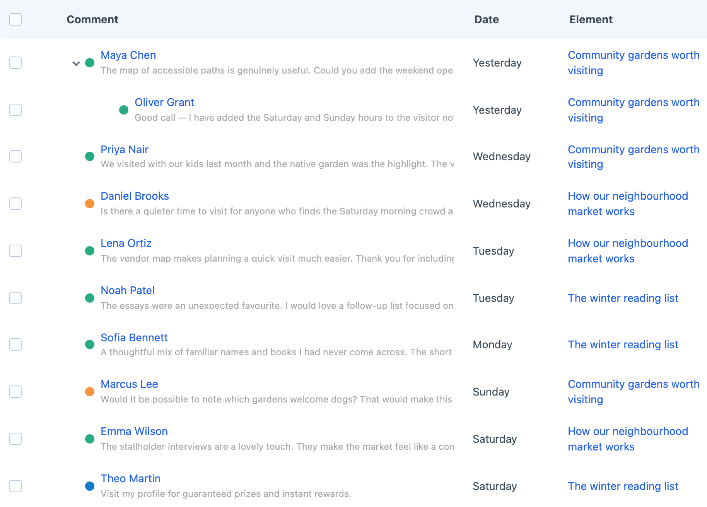

# Comments

A Comment is a message someone leaves on something on your site, such as a blog post, a product page or a user's profile. That entry, product or other element is the comment's owner, and every comment belongs to the one site it was made on. People can reply to each other's comments, so the comments on an element form threads of discussion.

Comments are Craft elements, so they work much like entries in the control panel and in templates. Open **Comments** in the control panel to see every comment on the site. You need Craft's **Access Comments** permission, and editing or deleting other people's comments needs the permissions described on [Permissions](docs:feature-tour/permissions).

## What a Comment Holds

Each comment has its text, its author and the date it was posted. It can also have a GIF from GIPHY, when [Reply with GIFs](docs:feature-tour/reply-with-gifs-giphy) is turned on, and the custom fields you add in **Comments → Settings → Comments Form → Form Layout**, such as a star rating or a website address. [Custom Fields](docs:template-guides/custom-fields) explains how those fields appear in the comment form.

Comments also record the page URL the comment was posted from, and the commenter's IP address and browser user agent. These never appear on the site, but they're useful when you're deciding whether a comment is genuine, and the [security lists](docs:feature-tour/security) can match against them. Visitors can vote comments up or down and flag them, and each comment keeps its votes and flags as well.

## Signed-In Users and Guests

A comment's author is either a Craft user who was signed in when they commented, or a guest. A signed-in user's name and email address come from their user account, so they only need to write the comment.

Guests can comment only when **Allow Guest Comments** is turned on in **Comments → Settings**, and it's off by default. The default comment form asks guests for their name and email address when **Show Email and Name for Guests** or **Require Email and Name for Guests** is turned on, and both are on by default. **Require Email and Name for Guests** makes them compulsory, so a guest can't post anonymously. A guest can't use an email address that belongs to a user account, so nobody can comment as one of your users without signing in.

Signed-in users can edit and delete their own comments on the site. Guests can't change a comment once it's posted, because there's no account to tie it back to them.

## Replies and Threads

A reply belongs to the same element as the comment it answers, and sits under it in the thread. Replies can have replies of their own, as deep as **Maximum Reply Depth** allows. Leave it empty for no limit, set it to `0` to turn replies off, or set a number such as `2` to allow replies to comments and replies to those replies, but nothing deeper.

The comments index shows the same threads, with each reply indented under the comment it answers, and a comment's page lists its direct replies under **Replies**.

## Statuses

Every comment is **Approved**, **Pending**, **Spam** or **Trashed**. Only approved comments appear on the site, unless you change [`defaultQueryStatus`](docs:get-started/configuration#defaultquerystatus) or ask for other statuses in your own [comment queries](docs:getting-elements/comment-queries).

A new comment is pending when moderation is required, which it is by default, and approved otherwise, as [Moderating Comments](#moderating-comments) explains. The [security lists](docs:feature-tour/security) can also hold a comment for moderation or mark it as spam when it contains certain words, email addresses or IP addresses.

When a signed-in user deletes their own comment on the site, it becomes **Trashed** and disappears from the site, but it stays in the comments index. You can still read it there, and set it back to **Approved** if it was removed by mistake.

When a user edits an approved comment on the site and moderation is required, the comment goes back to pending until a moderator approves the change. Editing doesn't change the status of a comment that's pending, spam or trashed, so a user can't edit their way out of a moderator's decision.

## Where Visitors Can Comment

By default, visitors can comment on every element you show a comment form for. To limit commenting to some parts of the site, open **Comments → Settings → Permissions**. It lists your entry sections, category groups, asset volumes and user groups, and you can choose which of each allow comments. Entry types are listed too, for entries that don't belong to a section, such as nested entries in a Matrix field. For example, choosing only your **Blog** section means visitors can comment on blog posts but not on your **Pages** or **Products** sections. Elements from other plugins always allow comments, because only Craft's own element types are listed. The same choices can be made with the [`permissions`](docs:get-started/configuration#permissions) setting.

To turn comments on or off for one element, such as closing comments on a single post that's attracting the wrong kind of attention, add a **Comment Options** field to the element's field layout. It shows an **Enable comments** lightswitch on the element, and turning it off closes comments on that element alone. The field's **Default Value** setting decides whether comments are enabled on elements that haven't been saved with the field yet.

Comments can also close by themselves. **Auto-close Comments** closes commenting on elements whose **Post Date** is more than that many days ago, which suits a news site where discussion on old articles mostly attracts spam. It only affects elements that have a post date, such as entries. **Maximum Comments per-user** limits how many comments each signed-in user can make on one element.

When commenting is closed or not allowed, the existing comments are still shown, but the default templates leave out the comment form and show the **Guest Notice** in its place, if you've set one. It's a good place to ask guests to sign in when **Allow Guest Comments** is off.

## Finding Comments

The comments index lists every comment under **All comments**, in thread order by default. Use the status menu beside the search box to show only one status, such as **Pending** to see what's waiting for a decision. The search box matches a comment's text and its author's name and email address.

For anything more specific, use Craft's filter button beside the search box. Comments adds rules for the **Comment** text, the author's **Name** and **Email**, the **URL** it was posted from, the **Owner** element and **Owner Type**, and the owner's **Entry Section** and **Entry Type**. For example, choosing the **Pending** status with an **Entry Section** rule for your **Blog** section shows the blog comments that are waiting for approval.

By default each row shows the author's name over the start of the comment, the date and the element the comment was made on, which links to that element's own edit page. Open Craft's **View** menu to change the columns and sort order. Further columns include the author's **Email** and **Name**, and the comment's **Votes**. Administrators can change the index's default sort with [`sortDefaultKey`](docs:get-started/configuration#sortdefaultkey) and [`sortDefaultDirection`](docs:get-started/configuration#sortdefaultdirection).

To keep an eye on new comments from the dashboard, add the **Comments** widget. It lists the latest comments, and its settings choose how many to show and which status. Turn on **Show Flagged Comments** to list only comments that visitors have flagged, which is a quick way to find the ones that need attention.

## Moderating Comments

**Comments Require Moderation** is turned on by default, so new comments wait as pending until a moderator approves them. Turn it off in **Comments → Settings** when you'd rather comments appear straight away and you only deal with problems afterwards.

Choose a **Moderator User Group** for the people who look after comments. Members of that group are the ones who receive moderator notification emails, and with **Exclude Moderator Comments** turned on, which is the default, their own comments are approved straight away. Turn on **Enable Moderator Notifications** and **Enable Moderator Edited Notifications** under **Comments → Settings → Notifications** so moderators hear about new pending comments, and about edits that need approving again, without checking the index.

To approve comments, choose the **Pending** status in the index, select the comments, and choose **Approved** from the **Set status** menu. The same action marks comments as spam or trashed, or approves a comment that was held by mistake. You can also open a comment and change its **Status** in the sidebar, then choose **Save**. Approving a pending comment is when its notifications go out, such as the emails to the author of the element it was made on and to the person it replies to, according to your notification settings.

Visitors flag comments they think are inappropriate. Flags don't change a comment's status, but once a comment reaches the **Flagged Comments Threshold**, five flags by default, the default templates show "Comment marked as inappropriate" in place of its text. Flagging is set up under **Comments → Settings → Flagging**, and the [`flaggedCommentLimit`](docs:get-started/configuration#flaggedcommentlimit) setting describes it.

## Editing a Comment

Click a comment in the index to open its page. The main area has the comment's text under **Comment**, any custom fields from the comment form layout, and the comment's direct replies under **Replies**. The sidebar shows its **Status**, its author, linked to their user account when they have one, and the element it was made on, linked to that element's edit page. Under those are the URL it was posted from, the IP address and user agent, and when it was created and last updated.

You can correct the text, such as removing a phone number someone posted, change the custom fields or change the status, then choose **Save**. Saving a comment written by someone else, including a guest, needs the **Edit other users’ comments** permission, and setting someone else's comment to **Trashed** here also needs **Trash other users’ comments**.

## Deleting Comments

Deleting a comment removes it from the site and from the comments index. Select the comments in the index and choose **Delete** from the actions menu. Anyone with access to the comments index can delete their own comments, and deleting other people's comments needs the **Delete comments** permission.

To hide a comment from the site while keeping it on record, set its status to **Spam** or **Trashed** instead, so it stays in the index where you can find it later.
