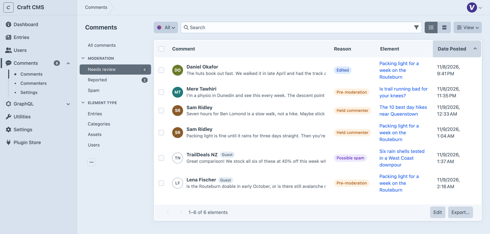
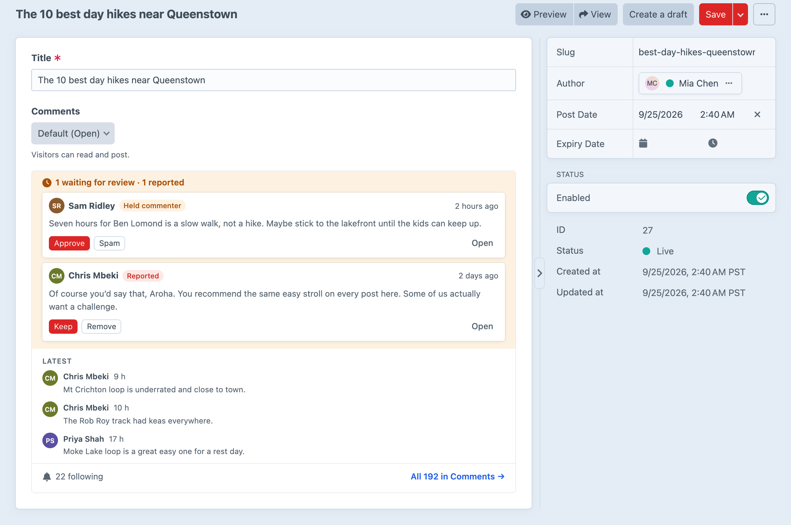

# Control Panel
Comments are managed through Craft's native element index and editor, so filtering, searching, table configuration and bulk actions work the same way as entries and other Craft elements. The **Comments** section of the control panel has up to three pages, depending on who's signed in: **Comments**, the index, for anyone with the `comments-view` permission, **Commenters** for moderators, and **Settings** for admins when Craft's `allowAdminChanges` setting is on.

## The Comments Index
**All comments** lists every comment. Moderators also see a **Moderation** group with **Needs review**, **Reported** and **Spam**, each with a count of what's waiting, and the same total appears beside **Comments** in the navigation. [Moderation](docs:feature-tour/moderation#the-needs-review-reported-and-spam-sources) explains how to work through them.

Under **Element Type**, the **Entries**, **Categories**, **Assets** and **Users** sources list comments on one type of element. These stay predictable on large sites, because they don't create a source for every element. Use Craft's condition builder when you need to filter by a specific element, entry section or entry type.

Each row shows the commenter's photo, or their initials on a colour, with their name above an excerpt of the comment. Guests are marked with a **Guest** label. The element and date posted are shown by default, and the moderation sources lead with a **Reason** column saying why each comment needs someone. You can add the date updated, email, name, votes and reports as columns. Use Craft's status menu to narrow any source to Approved, Pending, Spam, Removed or Deleted by author comments, or to see what's in the trash.

Select one or more rows to act on them in bulk. Moderators can approve, keep, remove, mark as spam or mark as not spam, depending on the source. People with `comments-delete` can move comments to the trash, and those with `comments-trash` can restore them. See [Permissions](docs:feature-tour/permissions#user-permissions) for what each permission allows.

## Editing a Comment
Clicking a comment opens Craft's element editor, full-page or in a slideout. Its first tab, **Content**, holds the comment and any fields from your [comment field layout](docs:template-guides/custom-fields). For a guest's comment, it also has their name and, for admins, their email address. Moderators get an **Activity** tab after it, with the comment's history and moderators' notes.

The sidebar starts with the element the comment is on, its author and its status, then the moderation decisions while the comment needs one, then its dates. People with `comments-edit` can move a comment to another element, which moves its whole thread, and change its author. **Preview** opens the comment in its thread on the site, and **View** opens it in a new tab. [Moderation](docs:feature-tour/moderation#deciding-a-comment) covers the decisions, the sidebar and the Activity tab in detail.

Comments come from the site, GraphQL or an import, and can't be created in the control panel.

## Commenters
**Commenters** lists everyone who has commented, with their counts and review setting, and a page for each person with their comments and history. It needs the `comments-moderate` permission. See [Commenters](docs:feature-tour/moderation#commenters).

## Comments Field
A **Comments** field gives editors control over one element's discussion, and puts what needs attention on that element in front of them. Create the field under **Settings** → **Fields**, then add it to the field layouts of the entry types, category groups, volumes or user layouts where editors need it.

We recommend giving the field a tab of its own, named **Comments**, in each entry type's field layout. It then stays out of the way of writers working on the content, while moderators and editors know where to look. The field's label is the card's heading, so a short label such as “Comments” suits it.

The select at the top decides whether the element takes comments. **Default** follows your [source settings](docs:feature-tour/permissions#which-elements-can-have-comments) and shows what they give in brackets, such as **Default (Open)**. **Open**, **Closed** and **Off** override them for this element, and a note under the select explains the option chosen. [Per-Element Settings](docs:feature-tour/permissions#per-element-settings) describes each one.

Below the select, people with the `comments-view` permission see a summary of the discussion once the element is saved:

- Comments waiting for review, with **Approve** and **Spam**, and reported comments, with **Keep** and **Remove**, each tinted and with a link to open it. Moderators can decide these without leaving the element. A held comment can only be removed from its own page, where you can give a reason.
- The latest approved comments, with each commenter's photo or initials.
- How many people follow the discussion, and a link to all of the element's comments in the Comments index.

Turn off **Show Comments Summary** in the field's settings to leave only the select, for example in a layout used by writers who don't moderate. It's on by default.

## Dashboard Widget
The **Comments** widget lists recent comments on the dashboard. You can set its heading and sub-heading, how many it shows, and which status to show. Turn on **Show Reported Comments** to list only comments with an open report.

## Feed Me
With the Feed Me plugin installed, you can import comments using its Comment element type.
