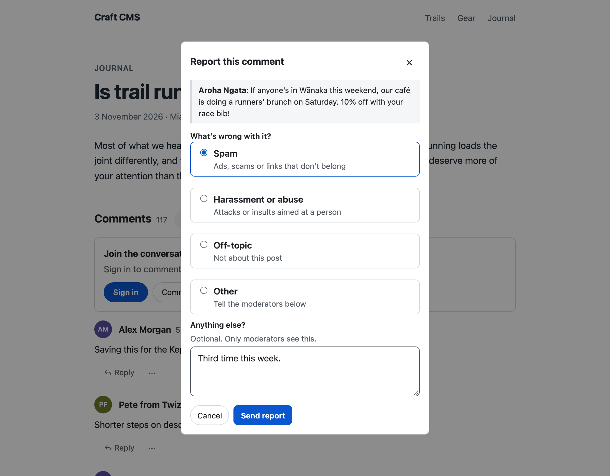

# Interactions
Interactions let visitors react to a comment without writing a reply. Choose how under **Comments** → **Settings** → **Interactions**, or with the [`interactionMode`](docs:get-started/configuration#interactionmode) setting.

| Interaction Mode | Setting Value | What Visitors See |
| --- | --- | --- |
| None | `none` | No reactions. |
| Likes (upvote only) | `like` | A Like button with a count. This is the default. |
| Upvotes and downvotes | `updown` | Upvote and Downvote buttons with their counts, and a net score. |

Each person has one reaction per comment. Pressing the same button again takes it back, and pressing the other button switches to it. Only approved comments can be voted on.

Voting needs an account unless you turn on **Allow Guest Interactions**. A guest's vote is tied to a cookie in their browser, so someone who clears it could vote again. Votes are limited to 60 a minute for each person, which is counted per user for signed-in visitors and per IP address for guests. Check [Client IP Addresses](docs:feature-tour/security#client-ip-addresses) if your site is behind a proxy, so that guests don't share a limit.

## Sorting by Votes
While interactions are on, the sort menu above the comments offers **Top**, which ranks comments by score, alongside newest and oldest first. You can make it the initial order with [`craft.comments.render()`](docs:template-guides/rendering-comments):

```twig
{{ craft.comments.render(entry.id, { sort: 'top' }) }}
```

For a list of the votes someone has made, see [Finding User Votes](docs:template-guides/finding-user-votes).

## Reporting a Comment
Visitors can also ask a moderator to look at a comment. **Report…** in a comment's menu opens **Report this comment**, which quotes the comment and asks what's wrong with it, from your **Report Reasons**. Nothing is chosen until the visitor picks a reason, and they can add anything else in an optional box that only moderators see.



Signed-in visitors can report comments while **Allow Reporting** is on, which it is by default, and **Allow Guest Reports** extends that to guests. Set both, and the reasons, under **Comments** → **Settings** → **Interactions**. Only approved comments can be reported, and reporting the same comment again withdraws that person's report. Reports are limited to 3 every 10 minutes for each person, counted the same way as votes.

A reported comment stays on the site until a moderator decides what to do with it. [Moderation](docs:feature-tour/moderation#reports) explains how moderators work through reports.
