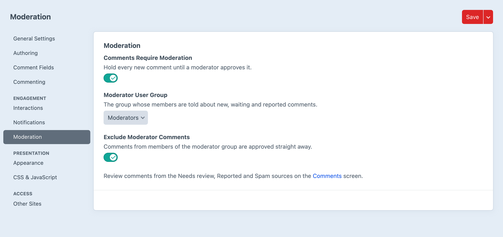
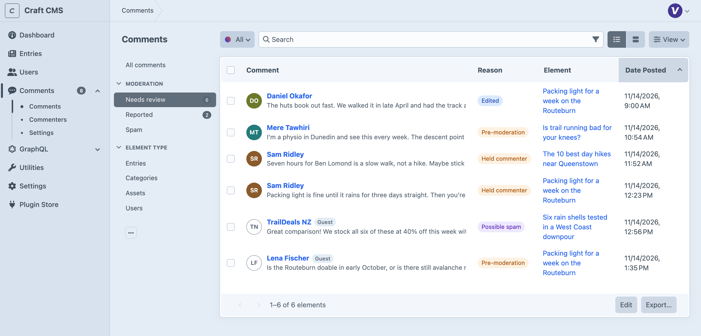
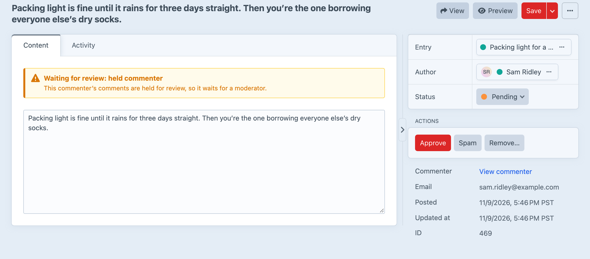
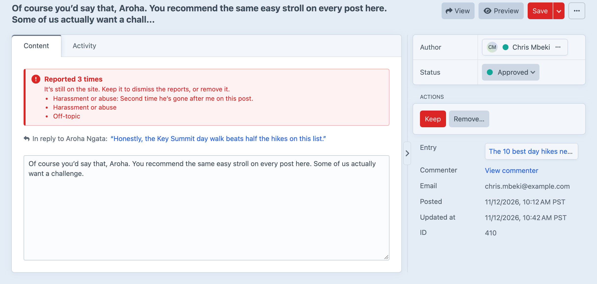
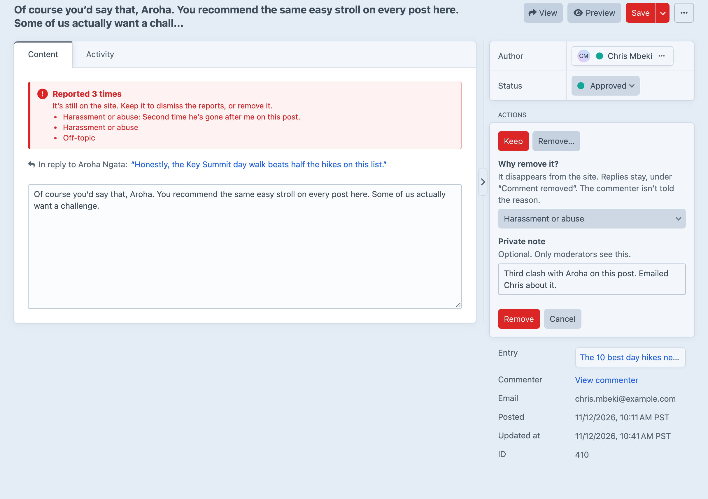
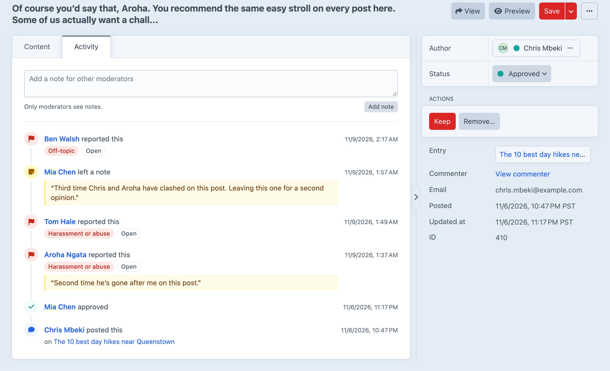
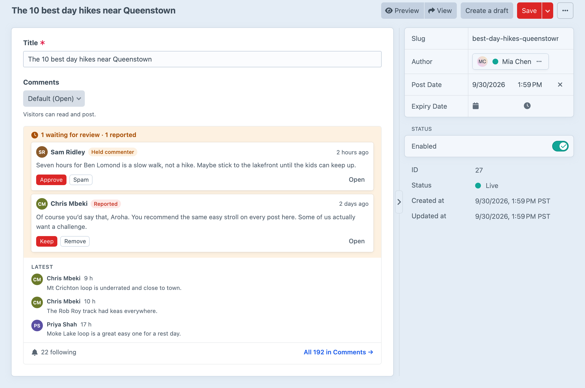
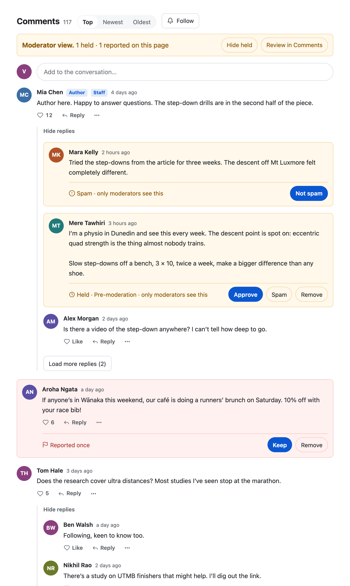
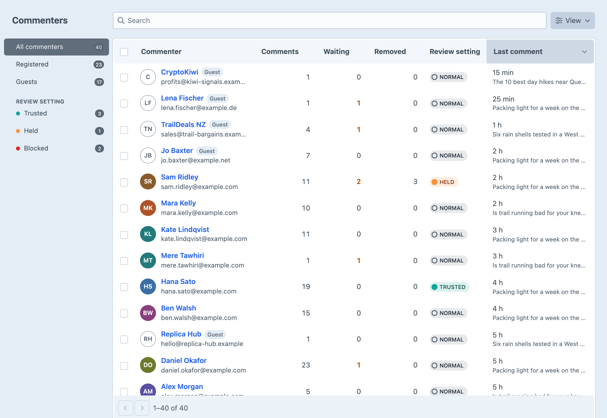
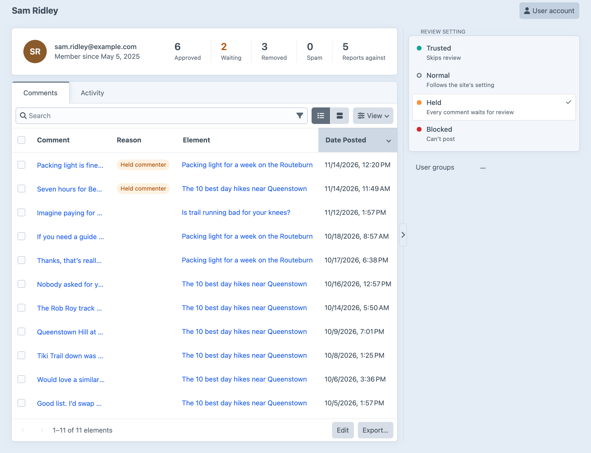

# Moderation
Moderation decides what's public, and lets you deal with people as well as individual comments. It suits any site where comments shouldn't appear without someone checking them first, and it also works after the fact on a site that publishes straight away, where visitors report anything that needs a second look.

Moderators work in the Comments index in the control panel. Anyone with the `comments-moderate` permission sees a **Moderation** group of sources there, and a count beside **Comments** in the navigation of the comments waiting under **Needs review** and **Reported**. See [Permissions](docs:feature-tour/permissions#user-permissions) for what each permission allows.

## Comment Statuses
A comment has one of these statuses, and only **Approved** comments are public.

| Status | Meaning |
| --- | --- |
| Approved | Public. |
| Pending | Waiting for a moderator, shown under **Needs review** unless its author deletes it. |
| Spam | Found to be spam by a spam classifier or a keyword filter, or marked as spam by a moderator. |
| Removed | Taken down by a moderator. |
| Deleted by author | Deleted by the person who wrote it. It's hidden from the site but stays in the control panel. It leaves **Needs review**, but stays under **Reported** while it has open reports, so you can still act on its author. |

This is separate from Craft's trash. Craft's **Delete** action moves a comment to the trash, where someone with the `comments-trash` permission can bring it back with **Restore**. A comment is only deleted permanently when someone with the `comments-delete` permission chooses **Delete permanently** in Craft's trash, or **Delete permanently…** on a spam comment's page if they can also moderate, or when Craft's garbage collection empties the trash.

Hiding a comment doesn't take its replies with it. An approved reply under a comment that's pending, spam, removed, trashed or deleted by its author stays in place under a “Comment unavailable.” placeholder, and is still counted. A comment with replies can't be deleted permanently until they've gone, and when garbage collection purges a trashed comment, its replies join the top of their thread, or start a new one.

## Reviewing Comments Before They're Public
**Comments Require Moderation** under **Comments** → **Settings** → **Moderation** is on by default, so new comments start as Pending and wait for a moderator. Turn it off to publish comments straight away and moderate afterwards. Choose a **Moderator User Group** to say who your moderators are. Its members can be emailed about comments waiting for review through the [staff notifications](docs:feature-tour/notifications-subscriptions#staff-notifications), and **Exclude Moderator Comments**, which is on by default, lets its members' own comments skip moderation.

With pre-moderation off, turn on **Hold First Comments** to hold each person's comments until a moderator has approved one of them. After that, their comments appear straight away, so you only check newcomers. Commenters with the **Trusted** review setting, and members of the **Moderator User Group** while **Exclude Moderator Comments** is on, aren't held. Guests are recognised as described under [Commenters](#commenters), so a guest who clears their cookies starts again.

A comment can wait for review for several reasons, and the index's **Reason** column shows which:

- **Pre-moderation** means every comment on the site waits for a moderator.
- **Held commenter** means the person who wrote it has the **Held** review setting, described under [Commenters](#commenters).
- **Possible spam** means spam protection wasn't sure about it and held it for you rather than rejecting it.
- **Keyword filter** means it contains one of your [Moderated Keywords](docs:feature-tour/security#keyword-filters). A comment caught by the **Spam Keywords** has this reason under **Spam**.
- **Too many links** means it has more links than [Maximum Links](docs:feature-tour/anti-spam#content-rules) allows.
- **First comment** means **Hold First Comments** is on and none of the commenter's comments have been approved yet.
- **Edited** means it was approved, then edited by its author while moderation applied to them, so it's waiting for review again.
- **Held by a moderator** means someone moved it back to Pending.

An author's edit goes through the same check as a new comment. With moderation on, or for a held commenter, editing an approved comment sends it back to Pending and hides it from the site until it's approved again. A comment that's already waiting keeps the reason it was first held for, and its author can't edit it at all once it's Spam or Removed.

## The Comments Index
**Comments** opens on **All comments**, and moderators also see the **Moderation** sources described below. Under **Element Type**, the **Entries**, **Categories**, **Assets** and **Users** sources list comments on one type of element. Use Craft's condition builder to filter by a specific element, section or entry type. Searching, sorting, table columns and bulk actions work as they do for entries.

Each row shows the commenter's photo, or their initials on a colour, with their name above an excerpt of the comment and a **Guest** label for guests. You can add the date updated, name, votes and reports as columns, and admins can also add the commenter's email. Craft's status menu narrows any source to one status, or shows what's in the trash. People with `comments-delete` can move comments to the trash from here, and those with `comments-trash` can restore them.

Comments come from the site, GraphQL or an import, such as with Feed Me's Comment element type. A new discussion can't be started in the control panel, but moderators can [reply to a comment](#replying-to-a-comment) from its page in the control panel.

## The Needs Review, Reported and Spam Sources
Open **Comments** and choose a source under **Moderation**:

- **Needs review** lists pending comments, oldest first, so nothing waits longest by accident. A pending comment its author deletes leaves it.
- **Reported** lists approved comments with at least one open report, oldest first. They're still on the site while they wait.
- **Spam** lists comments marked as spam, newest first.

The moderation sources show the reason, element and date posted by default. Select comments to decide them in bulk. **Needs review** offers **Approve**, **Mark as spam** and **Remove**, **Reported** offers **Keep** and **Remove**, and **Spam** offers **Not spam**. Bulk actions never delete a comment permanently, and bulk removal doesn't ask for a reason.

To see what's waiting on one element, open the element and use its [Comments field](#moderating-from-an-element), or follow its link to the index filtered to that element.

## Deciding a Comment
Open a comment to see it in Craft's element editor, full-page or in a slideout. Its **Content** tab holds the comment and any fields from your [comment field layout](docs:template-guides/custom-fields), and for a guest's comment, their name and, for admins, their email address. While it waits, a notice at the top of the **Content** tab says why. A pending comment says which rule held it, a reported one lists each report's reason and note, and a spam comment lists what spam protection found, such as an Akismet result or a failed bot check. A reply also shows the comment it's replying to, linked to that comment's page.

The decisions sit under **Actions** in the sidebar, and change with the comment's status:

| Status | Decisions | What They Do |
| --- | --- | --- |
| Pending | **Approve**, **Spam** and **Remove…** | **Approve** publishes the comment, and **Spam** hides it and moves it to the Spam source. |
| Approved with open reports | **Keep** and **Remove…** | **Keep** dismisses the open reports and leaves the comment on the site. |
| Spam | **Not spam**, and **Delete permanently…** for people who also have the `comments-delete` permission | **Not spam** returns the comment to **Needs review**, so a moderator still decides whether it goes up. |
| Removed | **Restore** | **Restore** publishes the comment again. |

**Remove…** and **Delete permanently…** are described below. A decision saves the form too, so any edits you've made to the comment are kept with it.

**Remove…** opens a short form asking why. Choose **Off-topic**, **Harassment or abuse**, **Personal information**, **Advertising** or **Other**, and add a private note if it helps the next moderator. The reason is kept in the comment's history, and the commenter isn't told it. Removing a reported comment resolves its reports, and so does marking it as spam.

On a comment's page, **Delete permanently…** is only offered for a spam comment, one at a time, and asks you to confirm, because it can't be undone. Removing and marking as spam both keep the comment, so you can change your mind later.

The **Status** menu in the sidebar changes a comment's status directly. Moving an approved comment back to Pending holds it, with the reason **Held by a moderator**.

Moderators can't make decisions on their own comments, from the control panel or the site, which keeps someone from approving their own work. Removing and restoring also need the `comments-trash` permission.

### The Comment's Sidebar
The top of the sidebar shows the element the comment is on, its author and its status. People with the `comments-edit` permission can change the element and the author with Craft's element pickers. Only a thread's first comment offers the element picker, because moving a comment moves its replies with it. A guest's name and email address are edited on the **Content** tab instead, and only admins see the address.

Under that are the comment's dates and ID, and for admins the page it was posted from, its IP address and user agent. The author's name links to their page in [Commenters](#commenters). **Preview** opens the comment in its thread on the site, where moderators can see held comments too, and **View** opens it in a new tab.

### The Activity Tab
The **Activity** tab, after the comment's own fields, is the comment's history, newest first. It shows when the comment was posted and edited, each decision and who made it, removal reasons, reports with the reporter's name and note, and notes from moderators.

Use the note box at the top to leave something for other moderators, such as why you kept a borderline comment. A note is added as soon as you press **Add note**, or Cmd/Ctrl+Enter, without saving the comment, so it won't lose an edit you're part-way through. Only moderators see notes, and the private note from a removal appears here too. The tab needs the `comments-moderate` permission.

Editing a comment's content needs `comments-edit`, so someone with only `comments-moderate` sees it read-only and makes decisions without changing what was written.

### Replying to a Comment
Moderators can answer a comment without going to the site. **Reply** sits beside **Preview** at the top of a comment's page, and in the **…** menu when the comment is open in a slideout. It opens a slideout with the comment quoted above a box for your reply, using the same editor and features as the site's comment form when [rich authoring](docs:feature-tour/rich-authoring) is on.

**Post reply** publishes the reply under the comment straight away, as you, with your account's name and avatar. It isn't held for review or checked for spam. Everyone who would hear about a reply on the site is told the same way, including the commenter and anyone following the discussion.

Replying needs the `comments-moderate` permission, and is only offered for comments that are published, including reported ones, so decide a waiting comment before answering it. Staff can still reply in a discussion that's closed, but not where comments are turned off, and **Maximum Reply Depth** applies as it does on the site.

## Moderating from an Element
An element's Comments field, set up as described in [Per-Element Settings](docs:feature-tour/permissions#per-element-settings), shows people with the `comments-view` permission a summary of its discussion once the element is saved:

- Comments waiting for review, with **Approve** and **Spam**, and reported comments, with **Keep** and **Remove**, each tinted and with a link to open it. Moderators can decide these without leaving the element. A held comment can only be removed from its own page, where you can give a reason.
- The latest approved comments, with each commenter's photo or initials, and **Reply** for moderators, which opens the same reply slideout as a [comment's page](#replying-to-a-comment). Reported comments have **Reply** too.
- How many people follow the discussion, and a link to all of the element's comments in the Comments index.

Turn off **Show Comments Summary** in the field's settings to leave only the select, for example in a layout used by writers who don't moderate. It's on by default.

## Moderating from the Site
Moderators can review the discussion where it happens. Anyone with the `comments-moderate` permission sees pending and spam comments in place on the public page, tinted and labelled with why they're there, such as “Held · Pre-moderation · only moderators see this”. Reported comments are tinted too, with how many times they've been reported. A bar above the comments counts what's held and reported on that page, with **Hide held** to see the page as visitors do and **Review in Comments** to open the index filtered to that element.

Held and reported comments have the same decisions as in the control panel, apart from asking for a removal reason. Approved comments have **Remove** and **Mark as spam** in their menu. Removed comments don't appear on the site, even to moderators, so restore them from the control panel.

## Dashboard Widget
The **Comments** widget lists recent comments on the dashboard. You can set its heading and sub-heading, how many it shows, and which status to show. Turn on **Show Reported Comments** to list only comments with an open report.

## Reports
Visitors report a comment with **Report…** in its menu, choosing one of your **Report Reasons** and optionally adding more detail. [Interactions](docs:feature-tour/interactions#reporting-a-comment) explains what they see and who can report. A reported comment stays public, and appears under **Reported** as soon as it has an open report.

Open a reported comment to read its reports, then choose **Keep** to dismiss them or **Remove…** to take the comment down. Each report and its outcome stays in the comment's Activity tab. To be told when a report arrives, turn on **New reports** under [Staff Notifications](docs:feature-tour/notifications-subscriptions#staff-notifications).

Set the reasons with **Report Reasons** under **Comments** → **Settings** → **Interactions**. Each has a label, a short explanation shown in the dialog, and a value that's stored with each report, so you can reword a label without affecting reports already made.

## Commenters
**Comments** → **Commenters** lists the people behind comments, for moderators deciding what to do about one of them rather than one comment. It needs the `comments-moderate` permission. Sources narrow the list to **Registered** users or **Guests**, and to people with a **Trusted**, **Held** or **Blocked** review setting, each with a count. Search by name, or by email address if you're an admin.

Open someone to see their comments, with counts of how many were approved, are waiting, were removed or marked as spam, and how many reports have been made against them. The sidebar has their review setting and its history. Only admins see email addresses, including whether a guest's comment emails are being sent.

### Review Settings
A review setting decides how one person's comments are moderated, whatever the site setting says:

| Review Setting | Effect |
| --- | --- |
| Trusted | Their comments skip review and appear straight away, even under pre-moderation. Spam checks and keyword filters still apply. |
| Normal | Their comments follow the site's moderation setting. This is the default. |
| Held | Every comment they post or edit waits for a moderator, until you change this. |
| Blocked | They can't post, edit, vote, report or follow a discussion, though they can still stop following one. Their existing comments stay as they are. |

Trusted suits your regulars on a pre-moderated site, so you aren't approving the same people every day. Held suits someone whose last few comments needed removing, and Blocked someone who shouldn't comment at all. Choose a setting and add a note if it helps, which is kept in the history and only moderators see. Blocking asks you to confirm first. You can also select several people in the list and set their review setting together.

A review setting lasts until a moderator changes it. A setting that only applies to one discussion is listed under **In one conversation**, where you can remove it. Where more than one applies, Held and Blocked take priority over Trusted.

Registered users are recognised by their account. Guests are recognised by a cookie in their browser, so someone who clears it or changes browser arrives as a new guest, and a review setting on their old record won't follow them. A commenter's page says whether a guest can be recognised.
