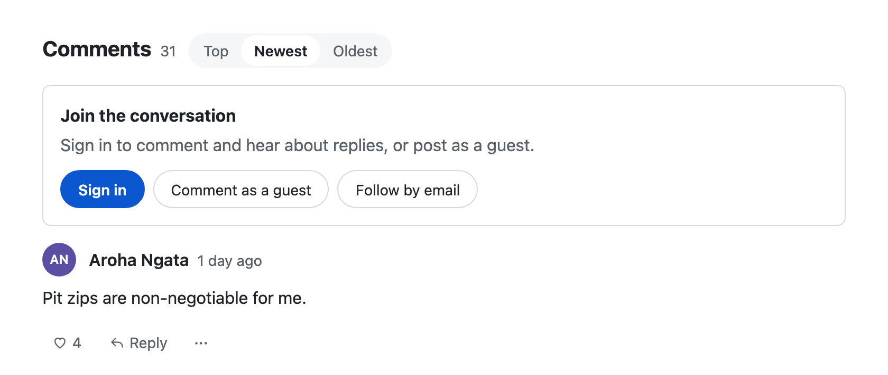

# Notifications and Subscriptions
Comments tells people when something happens in a discussion they're part of, and tells staff when something needs attention. How each person hears about it depends on whether they have an account.

Guests have no account or other way to hear from your site, so Comments emails them, once they've confirmed their address. People with a user account, including your moderators, aren't emailed by Comments. Instead, Comments fires the [`afterNotify` event](docs:developers/events#the-afternotify-event) naming who should hear about each comment, and your site or a notifications plugin delivers the message in whatever way suits it, such as an email, an in-app notice or a Slack message. Without anything listening for that event, people with an account aren't told.

Set this up under **Comments** → **Settings** → **Notifications**. Guest emails and the event are handled through Craft's queue by default, so posting a comment stays quick. Make sure your site's queue is running, and find any failed emails in Craft's queue manager.

## Notifications for People Taking Part
**Participant Notifications** decide which events tell people involved in a discussion. Each person hears once about a comment, even if more than one of these applies, and nobody is told about their own comment.

| Notification | Who It's For | Setting Value | On by Default |
| --- | --- | --- | --- |
| New comments to the owner author | The author of the element, such as an entry's author | `owner` | Yes |
| Direct replies to a comment author | The author of the comment being replied to | `reply` | Yes |
| Mentions in an approved comment | The person mentioned, through [Rich Authoring](docs:feature-tour/rich-authoring#mentions) | `mention` | Yes |
| Approval of a pending comment | The comment's author, once it's approved | `approved` | No |

A guest gets an email for replies to their comment and for their comment being approved. Element authors and mentioned people always have an account, so they're only ever named in the event.

Nobody is told about pending or spam comments. If a comment is approved later, these notifications go out then, once only, however many times it's held and approved again.

## Subscriptions
Subscriptions let people follow a discussion. They're off until you choose **Available Subscriptions**:

- **Whole discussion** (`conversation`) adds a **Follow** button above the comments, for news of every new comment on the element.
- **Replies to individual comments** (`replies`) tells someone about replies to a particular comment.

The default templates have a button for whole discussions only. Replies subscriptions come from **Default Subscription After Commenting**, or from your own form posting a `commentId` to `comments/comments/subscribe`. That setting can subscribe signed-in commenters automatically after they comment, to replies to their comment or to the whole discussion. It never subscribes someone who has already unsubscribed.

Subscribers with an account are named in the event, and confirmed guests are emailed.

## Guests
Anyone can type an address into a form, so a guest is only emailed after confirming the address is theirs. This covers reply, subscription and approval emails.



A guest can ask for emails in two ways. If reply notifications are on, the comment form offers “Email me when someone replies”. If whole-discussion subscriptions are on, the **Join the conversation** card offers **Follow by email**, which asks for an address. Either way they're sent an email with a link to a page where they press a button to confirm, because mail scanners follow links but don't press buttons. Confirmation links last a week.

A confirmed guest can follow other discussions without confirming again, as long as they're using the same browser. A guest can only follow whole discussions, not replies to individual comments. For an address belonging to a registered user, the guest sees the same message, but no email is sent. Confirmation requests are limited to one per address every 10 minutes, 5 an hour for each network, and 200 sent across the site each hour.

A guest's page in [Commenters](docs:feature-tour/moderation#commenters) shows admins whether their comment emails are being sent, not yet confirmed, or stopped.

## Unsubscribe Links
Every email to a guest ends with an unsubscribe link, and has `List-Unsubscribe` headers for one-click unsubscribing in mail clients. It's added after your message, so editing a message can't lose it.

The link leads to a small page at `/comments/manage` that works without an account or cookie, because it's signed for that person. A link from a subscription email offers to stop that discussion's emails or all comment emails, and other emails offer to stop all of them. Only pressing the button changes anything. Stopping all comment emails applies until that person subscribes to something again, which counts as asking for email again.

This page is rendered by the plugin and isn't one of the [templates you can override](docs:template-guides/custom-templates).

## Staff Notifications
**Staff Notifications** name the members of the **Moderator User Group**, chosen under **Comments** → **Settings** → **Moderation**, in the [`afterNotify` event](docs:developers/events#the-afternotify-event). Comments doesn't email staff, because they have accounts and the control panel, where the Comments navigation counts what's waiting for them. All four are off by default.

| Notification | When | Setting Value | Event Type |
| --- | --- | --- | --- |
| New comments awaiting approval | A comment is waiting for review | `moderator-pending` | `moderator` |
| Pending comments edited by their author | A waiting comment is edited | `moderator-edited` | `moderator-edit` |
| Every new comment | Any comment is posted, whatever its status | `staff-new` | `admin` |
| New reports | A visitor reports a comment | `staff-reported` | `flag` |

Without a moderator group, the event still fires for these, but names nobody.

## Customising Guest Emails
Edit the wording of each guest email in Craft's **Utilities** → **System Messages**. Comments adds a message for replies, for each kind of subscription, for approval, and for confirming an address. Messages are rendered in a Twig sandbox, with `comment`, `element` and `user`, the recipient, available. The sandbox allows an element's common properties such as `id`, `title` and `url`, its custom fields, and these properties of `comment`: `ownerId`, `ownerSiteId`, `userId`, `name`, `email`, `gifUrl`, `commentDate`, `comment`, `rawComment`, `excerpt`, `timeAgo`, `author`, `authorName`, `authorEmail`, `owner`, `user` and `cpEditUrl`. The guest confirmation message has only `siteName` and `confirmUrl`.

```twig
Hi {{ user.friendlyName }},

{{ comment.authorName }} replied on “{{ element.title }}”:

{{ comment.excerpt }}

{{ element.url }}#comment-{{ comment.id }}
```

To change the layout around the message, set **HTML Email Template** to a template in your site. It receives the rendered message as `body`, along with the same variables.

Modules and plugins can change or cancel the reply, subscription and approval emails using [events](docs:developers/events#notification-related-events).
