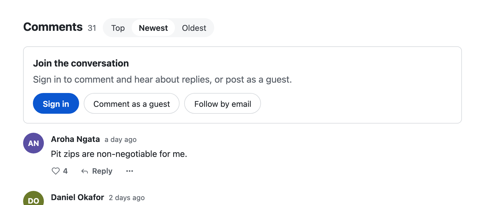

# Notifications & Subscriptions
Comments emails people when something happens in a discussion they're part of, and emails staff when something needs attention. People with a user account are emailed at their account's address. Guests are emailed once they've [confirmed their address](#confirming-a-guests-address).

Set this up under **Comments** → **Settings** → **Notifications**. Emails are sent through Craft's queue by default, so posting a comment stays quick. Make sure your site's queue is running, and find any failed emails in Craft's queue manager.

If your site has its own way of reaching people, such as an in-app inbox or a notifications plugin, it can take over any of these emails, or add to them, through [events](#delivering-notifications-another-way).

## Notifications for People Taking Part
**Participant Notifications** decide which events tell people involved in a discussion. Each person hears once about a comment, even if more than one of these applies, and nobody is told about their own comment.

| Notification | Who It's For | Setting Value | On by Default |
| --- | --- | --- | --- |
| New comments to the owner author | The author of the element, such as an entry's author | `owner` | Yes |
| Direct replies to a comment author | The author of the comment being replied to | `reply` | Yes |
| Mentions in an approved comment | The person mentioned, through [Rich Authoring](docs:feature-tour/rich-authoring#mentions) | `mention` | Yes |
| Approval of a pending comment | The comment's author, once it's approved | `approved` | No |

Element authors and mentioned people always have an account. A guest can be emailed about replies to their comment and about it being approved.

Nobody is told about pending or spam comments. If a comment is approved later, these notifications go out then, once only, however many times it's held and approved again.

## Subscriptions
Subscriptions let people follow a discussion. Visitors see this as **Follow** on the site, while the settings and GraphQL call it a subscription. Subscriptions are off until you choose **Available Subscriptions**:

- **Whole discussion** (`conversation`) adds a **Follow** button above the comments, for news of every new comment on the element.
- **Replies to individual comments** (`replies`) tells someone about replies to a particular comment.

The thread's **Follow** button covers whole discussions only. Subscriptions to replies come from **Default Subscription After Commenting**, from GraphQL's [`subscribeComment`](docs:graphql/mutations#the-subscribeComment-mutation) mutation with a `commentId`, or from a form posting a `commentId` to the `comments/comments/subscribe` form action. That setting can subscribe signed-in commenters automatically after they comment, to replies to their comment or to the whole discussion. It never subscribes someone who has already unsubscribed.

Subscribers are emailed, whether they have an account or are a confirmed guest. Commenters with the **Blocked** [review setting](docs:feature-tour/moderation#review-settings) can't follow a discussion, though they can still stop following one they already follow.

## Confirming a Guest's Address
Anyone can type an address into a form, so a guest is only emailed after confirming the address is theirs. This covers reply, subscription and approval emails.



A guest can ask for emails in two ways. If reply notifications are on, the comment form offers “Email me when someone replies”. If whole-discussion subscriptions are on, the **Join the conversation** card offers **Follow by email**, which asks for an address. Either way they're sent an email with a link to a page where they press a button to confirm, because mail scanners follow links but don't press buttons. Confirmation links last a week.

A confirmed guest can follow other discussions without confirming again, as long as they're using the same browser. A guest can only follow whole discussions, not replies to individual comments. For an address belonging to a registered user, the guest sees the same message, but no email is sent. Confirmation requests are limited to one per address every 10 minutes, 5 an hour for each network, and 200 sent across the site each hour.

A guest's page in [Commenters](docs:feature-tour/moderation#commenters) shows admins whether their comment emails are being sent, not yet confirmed, or stopped.

## Unsubscribe Links
Every email about a discussion, to a guest or someone with an account, ends with an unsubscribe link, and has `List-Unsubscribe` headers for one-click unsubscribing in mail clients. It's added after your message, so editing a message can't lose it.

The link leads to a small page at `/comments/manage` that works without signing in or a cookie, because it's signed for that person. A link from a subscription email offers to stop that discussion's emails or all comment emails, and other emails offer to stop all of them. Only pressing the button changes anything. Stopping all comment emails applies until that person subscribes to something again, which counts as asking for email again.

This page is rendered by the plugin rather than your site's templates, because it has to work on its own for someone following a link in an email.

## Staff Notifications
**Staff Notifications** email your staff about comments that need attention. All four are off by default.

| Notification | When | Who's Emailed | Setting Value |
| --- | --- | --- | --- |
| New comments awaiting approval | A comment is waiting for review | The **Moderator User Group** | `moderator-pending` |
| Pending comments edited by their author | A waiting comment is edited | The **Moderator User Group** | `moderator-edited` |
| Every new comment | Any comment is posted, whatever its status | The **Notification Recipients** | `staff-new` |
| New reports | A visitor reports a comment | The **Notification Recipients** | `staff-reported` |

The **Moderator User Group** is chosen under **Comments** → **Settings** → **Moderation**. **Notification Recipients** is a list of email addresses beside **Staff Notifications**, and each address can be switched off without removing it. In a config file, `notificationRecipients` takes rows such as `['email' => 'editor@example.com', 'enabled' => true]`, plain addresses, or a closure that returns either.

Nobody is emailed about something they did themselves, so a moderator isn't emailed about their own comment, their edit to it, or a report they made. Each email links to the comment in the control panel. They're checked again just before sending, so nobody is emailed about a comment that's no longer waiting, has been removed or deleted, or whose reports have been dealt with in the meantime.

## Delivering Notifications Another Way
Each email fires a `beforeSend…Email` event first, and a module or plugin can cancel it there and deliver that notification its own way. After a notification's emails, the [`afterNotify` event](docs:developers/events#the-afterNotify-event) names everyone it was for, whether or not their email was cancelled, so you can tell them through another channel as well, such as an in-app notice or a Slack message. See [Email Events](docs:developers/events#email-events).

## Customising Emails
Edit the wording of each email in Craft's **Utilities** → **System Messages**. Comments adds a message for new comments to the element's author, for replies, for mentions, for each kind of subscription, for approval, for confirming a guest's address, and for each staff notification.

Messages are rendered in a Twig sandbox, which limits what they can read. The guest confirmation message has only `siteName` and `confirmUrl`, and every other message has these variables:

| Variable | What It Holds |
| --- | --- |
| `comment` | The comment the email is about. |
| `element` | The element the comment is on. Its common properties, such as `id`, `title` and `url`, and its custom fields are available. |
| `user` | The person receiving the email. |

From `comment`, a message can read `id`, `ownerId`, `ownerSiteId`, `userId`, `name`, `email`, `commentDate`, `comment`, `rawComment`, `excerpt`, `timeAgo`, `author`, `authorName`, `authorEmail`, `owner`, `user` and `cpEditUrl`. It can also read the comment's custom fields that are shown on comments, as long as they were when the comment was posted. Fields that are **Not shown** or not asked for can't be read in an email however the message is written, so what commenters enter in them stays in the control panel.

```twig
Hi {{ user.friendlyName }},

{{ comment.authorName }} replied on “{{ element.title }}”:

{{ comment.excerpt }}

{{ element.url }}#comment-{{ comment.id }}
```

To change the layout around the message, set **HTML Email Template** to a template in your site. It receives the rendered message as `body`, along with the same variables.

Modules and plugins can change or cancel any of these emails using [events](docs:developers/events#email-events).
