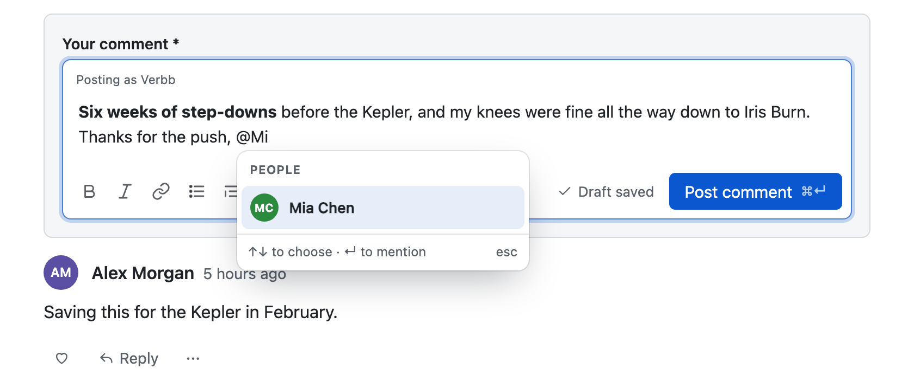

# Rich Authoring
By default, visitors write comments in a plain text box. Rich authoring replaces it with the Editor, so they can format what they write, mention people and add images or files. It suits a community that writes longer comments or needs to refer to code and quotes. A plain box suits a site that wants short replies and as little as possible to moderate.

Turn it on by setting **Authoring Mode** to **Rich (Editor)** under **Comments** → **Settings** → **Authoring**, or with the [`authoringMode`](docs:get-started/configuration#authoringmode) setting. The Editor is installed with Comments, so there's nothing else to set up. Commenters can use bold, italic, strikethrough, lists, quotes, code and links.

The setting decides how new comments are written. Each comment keeps the format it was written in, so changing the mode doesn't affect how existing comments display, and a rich comment can't be turned into a plain one by editing it.

Guests get the Editor with its formatting, while mentions and attachments need a visitor to be signed in. Without JavaScript, or until the Editor has loaded, visitors see a plain text box and can still post. A rich comment can't be edited that way, and trying shows an error rather than flattening it to plain text.

## Mentions
**Allow Mentions** is on by default. A signed-in commenter types `@` and at least two characters of a name, and picks from the suggestions. Suggestions are limited to people connected to the discussion: anyone who has commented on the element as a registered user, the element's author, and members of the **Moderator User Group**. This keeps your whole user list private, and keeps a mention from reaching someone with no connection to the page.

A mention links to the person's name when the comment displays. While the mention notification is turned on, which it is by default, the person is named in the notification event once the comment is approved, for your site or a notifications plugin to tell them. See [Notifications and Subscriptions](docs:feature-tour/notifications-and-subscriptions).

## Attachments
Turn on **Allow Attachments** and choose an **Attachment Volume** to let signed-in commenters add images and files. New files are only allowed with the types in **Allowed File Types** and sizes under **Maximum File Size**, which default to images and PDFs up to 10MB. Comments doesn't need commenters to have any access to the volume or the control panel, but they can only upload where they could comment.

An upload stays temporary until the comment it belongs to is posted, and uploads that are never posted are cleaned up by the Editor. A visitor who presses submit while a file is uploading is asked to wait, so it isn't lost. A comment can be nothing but an image or file.

Removing an attachment from a comment only removes it from that comment. The asset stays in your volume, so anything else using it keeps working.

## Custom Forms and the API
Forms from the default templates handle all of this. If you write your own, or need the Editor's JSON through GraphQL, `editorContent`, `contentFormat` and `contentHtml` are covered in [GraphQL](docs:developers/graphql), and the markup the Editor looks for is in [Custom Templates](docs:template-guides/custom-templates#rich-authoring). To show a rich comment from a [comment query](docs:getting-elements/comment-queries), output `comment.getRenderedBodyHtml()`. `comment.comment` holds only its plain text.
