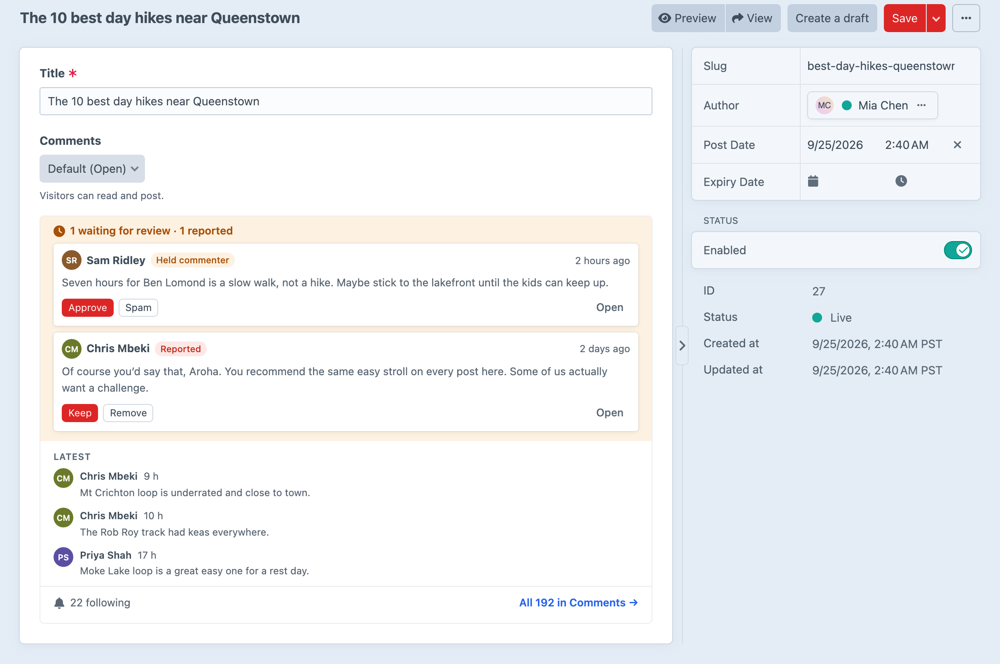

# Adding Comments to an Entry

Start with an entry that has a public page and a Twig template you can edit. You'll display the comments, post a comment and approve it, which is the path every comment takes with Comments' default settings. Then you'll add a Comments field, so editors can see and manage the discussion from the entry itself.

Two defaults affect this test. Guests can't comment until you turn on **Allow Guest Comments** under **Comments** → **Settings** → **Commenting**, so sign in as an ordinary user in a separate browser, or turn that setting on. New comments also wait for approval until you turn off **Comments Require Moderation** under **Comments** → **Settings** → **Moderation**.

## Showing Comments on the Page

Place this in the entry's template where its comments should appear:

```twig
{{ craft.comments.render(entry.id) }}
```

Open the page as your signed-in test user and you'll see a Comments heading, links to sort the comments, a message saying there are no comments yet, and the comment form. A signed-out visitor sees a **Join the conversation** card instead, with a way to sign in, and to comment as a guest when guests are allowed. Post a recognisable test message. The page tells you it's been submitted for moderation, because it isn't public yet.

## Approving the Comment

Go to **Comments** in the control panel and choose **Needs review**, where your message is waiting with the reason **Pre-moderation**. Open it and press **Approve** in the sidebar. Reload the public page to confirm it's visible, then try replying, voting and reporting as your test user.

Test the page with the permissions your visitors will have, not only an administrator account. Administrators and moderators see held comments on the page too, marked as only visible to them. If the form doesn't appear, check which elements can have comments in [Permissions](docs:feature-tour/permissions). If a comment saved but doesn't appear, check its status in the Comments index before changing the template.

## Adding a Comments Field

A Comments field lets editors open, close or turn off comments for one entry, and shows them what's waiting there. Create a field with the **Comments** type under **Settings** → **Fields**, then open your entry type's field layout, add a tab named **Comments**, and put the field on it. Keeping it on its own tab keeps it out of the way of people writing the entry.

Open your test entry and choose the **Comments** tab. The select shows **Default (Open)**, because your source settings allow comments, and under it are the latest comments and how many people follow the discussion. When a comment is waiting for review or has been reported, it appears here too, with buttons to decide it in place.



[Rendering Comments](docs:template-guides/rendering-comments) explains the options you can pass to `render()`, [Control Panel](docs:feature-tour/control-panel#comments-field) covers the Comments field in full, and [Moderation](docs:feature-tour/moderation) covers what moderators can do from here.
