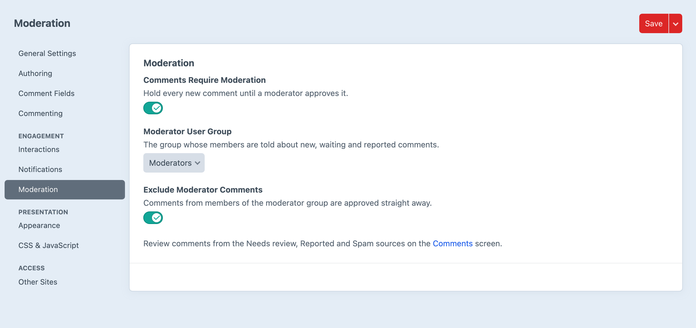

# Configuration

You can customise Comments’s settings using a PHP configuration file. This is optional: each setting has a default, so you only need to include the values you want to change.

To override a setting, create `comments.php` in your Craft project’s `/config` directory and return an array of setting names and values. For example, the following lets guests comment:

```php
<?php

return [
    'allowGuest' => true,
];
```

All other settings keep their defaults. Add any further settings you want to change to the same array. The options below explain the available settings and their defaults.

Like Craft's own config files, this one can vary by environment. Put shared values under `'*'` and overrides under the environment's name:

```php
<?php

return [
    '*' => [
        'allowGuest' => true,
    ],
    'dev' => [
        'useQueueForNotifications' => false,
    ],
];
```

## Control Panel

You can also manage most of these settings under **Comments** → **Settings**, which needs an admin account and Craft's `allowAdminChanges` setting turned on. A value in `config/comments.php` takes precedence over the control panel, and the settings screen shows a warning beside any field it overrides. The pages are General Settings, Authoring, Comment Fields, Commenting, Interactions, Notifications, Moderation, Spam, Appearance, and Templates & Resources, and the options below are grouped the same way.



## Configuration Options

### General

::: reference
#### `pluginName`

**Type:** `string` · **Default:** `'Comments'`

The label used for Comments in the control panel.
:::

::: reference
#### `closed`

**Type:** `bool` · **Default:** `false`

Stops new comments everywhere, while existing comments stay visible. A Comments field can't reopen a discussion while this is on. To hide a discussion completely, turn comments off for the element instead. See [Permissions](docs:feature-tour/permissions#per-element-settings).
:::

::: reference
#### `autoCloseDays`

**Type:** `int|null` · **Default:** `null`

Closes comments on an element this many days after its post date, leaving existing comments visible. Leave it empty to keep them open. Elements with no post date, such as assets and users, never close this way.
:::

::: reference
#### `sortDefaultKey`

**Type:** `string` · **Default:** `'commentDate'`

The sort used when opening the Comments index in the control panel. Supported values are `commentDate`, `dateUpdated`, `thread`, and `status`. This doesn't affect the public site, which uses [`orderBy`](#orderby).
:::

::: reference
#### `sortDefaultDirection`

**Type:** `string` · **Default:** `'desc'`

The direction of [`sortDefaultKey`](#sortdefaultkey), either `asc` or `desc`.
:::

### Commenting

These are under **Commenting** in the control panel, and explained in [Permissions](docs:feature-tour/permissions).

::: reference
#### `permissions`

**Type:** `array` · **Default:** `[]`

Which elements can have comments by default. An element type that isn't listed can have comments everywhere. For a type that is listed, use `'*'` to allow all of them, or an array of UIDs to allow only those. These are section or entry type UIDs for entries, category group UIDs for categories, volume UIDs for assets and user group UIDs for users.

```php
'permissions' => [
    'craft\elements\Asset' => [
        '33974e79-b3b6-47ec-af91-4519fe4985be',
    ],
    'craft\elements\Category' => [
        'a27827c8-4810-433c-acb9-261b53d46281',
    ],
    'craft\elements\Entry' => [
        'a8d4bdf1-164e-4ddc-aaad-640026b8d3bf',
    ],
    'craft\elements\User' => [
        'c23a4d8d-47f0-4e71-927c-d5897ec9c9f8',
    ],
],
```

[Permissions](docs:feature-tour/permissions) explains how this works with the Comments field.
:::

::: reference
#### `allowGuest`

**Type:** `bool` · **Default:** `false`

Whether visitors who aren't signed in can comment.
:::

::: reference
#### `guestNotice`

**Type:** `string|null` · **Default:** `null`

The message signed-out visitors see in place of the form when guests can't comment. Without one, they see “Must be logged in to comment.”
:::

::: reference
#### `guestRequireEmailName`

**Type:** `bool` · **Default:** `true`

Whether guests have to provide both a name and an email address.
:::

::: reference
#### `guestShowEmailName`

**Type:** `bool` · **Default:** `true`

Whether guests see name and email fields. They're shown regardless when [`guestRequireEmailName`](#guestrequireemailname) is on, because they're needed.
:::

::: reference
#### `maxUserComments`

**Type:** `int|null` · **Default:** `null`

The number of comments a signed-in user can have on one element, counting approved and pending ones. Leave it empty for no limit. Guests aren't counted.
:::

::: reference
#### `maxReplyDepth`

**Type:** `int|null` · **Default:** `null`

How many levels of replies comments can have. Leave it empty for no limit, or use `0` to turn replies off.
:::

### Authoring

These are explained in [Rich Authoring](docs:feature-tour/rich-authoring).

::: reference
#### `authoringMode`

**Type:** `string` · **Default:** `'rich'`

How visitors write comments. Supported values are `rich` for the Editor, with formatting and optional mentions and attachments, and `plain` for the same comment editor without the Editor, saving plain text.
:::

::: reference
#### `securityMaxLength`

**Type:** `string|null` · **Default:** `null`

The most characters a comment can have. Leave it empty for no limit.
:::

::: reference
#### `authorEditWindow`

**Type:** `int|null` · **Default:** `null`

How many minutes authors can edit or delete their own comment for. Leave it empty for no limit. People who can edit or delete anyone's comments aren't limited by it.
:::

::: reference
#### `allowMentions`

**Type:** `bool` · **Default:** `true`

Whether signed-in commenters can mention people when [`authoringMode`](#authoringmode) is `rich`.
:::

::: reference
#### `allowAttachments`

**Type:** `bool` · **Default:** `false`

Whether signed-in commenters can add images and files when [`authoringMode`](#authoringmode) is `rich`. This needs [`attachmentVolumeId`](#attachmentvolumeid).
:::

::: reference
#### `attachmentVolumeId`

**Type:** `int|null` · **Default:** `null`

The ID of the asset volume attachments are stored in. Required when [`allowAttachments`](#allowattachments) is on.
:::

::: reference
#### `attachmentExtensions`

**Type:** `array` · **Default:** `['jpg', 'jpeg', 'png', 'gif', 'webp', 'pdf']`

The file extensions commenters can attach.
:::

::: reference
#### `attachmentMaxSize`

**Type:** `int` · **Default:** `10`

The largest file commenters can attach, in megabytes.
:::

### Comment Fields

::: reference
#### `publicFields`

**Type:** `array` · **Default:** `[]`

The handles of the custom fields visitors can fill in through public forms and the API. Fields that aren't listed can only be edited in the control panel, and their being required doesn't stop a visitor from posting. See [Custom Fields](docs:template-guides/custom-fields).
:::

### Interactions

These are explained in [Interactions](docs:feature-tour/interactions).

::: reference
#### `interactionMode`

**Type:** `string` · **Default:** `'like'`

How visitors can react to a comment. Supported values are `none`, `like` for upvotes only, and `updown` for upvotes and downvotes. See [Interactions](docs:feature-tour/interactions).
:::

::: reference
#### `allowGuestVoting`

**Type:** `bool` · **Default:** `false`

Whether visitors who aren't signed in can vote.
:::

::: reference
#### `allowFlagging`

**Type:** `bool` · **Default:** `true`

Whether signed-in visitors can report comments, shown as **Allow Reporting**.
:::

::: reference
#### `allowGuestFlagging`

**Type:** `bool` · **Default:** `false`

Whether visitors who aren't signed in can report comments, shown as **Allow Guest Reports**.
:::

::: reference
#### `reportReasons`

**Type:** `array` · **Default:** see below

The reasons visitors choose from when reporting a comment. Each has a `label` and a short `description`, shown in the report dialog, and a `value`, which is what's stored with each report, so changing the `label` or `description` is safe.

```php
'reportReasons' => [
    ['value' => 'spam', 'label' => 'Spam', 'description' => 'Ads, scams or links that don’t belong'],
    ['value' => 'harassment', 'label' => 'Harassment or abuse', 'description' => 'Attacks or insults aimed at a person'],
    ['value' => 'off-topic', 'label' => 'Off-topic', 'description' => 'Not about this post'],
    ['value' => 'other', 'label' => 'Other', 'description' => 'Tell the moderators below'],
],
```
:::

### Notifications

These are explained in [Notifications and Subscriptions](docs:feature-tour/notifications-and-subscriptions).

::: reference
#### `useQueueForNotifications`

**Type:** `bool` · **Default:** `true`

Whether emails and the [`afterNotify` event](docs:developers/events#the-afternotify-event) are handled through Craft's queue rather than during the visitor's request, which keeps commenting fast. Turning this off suits a local environment with no queue runner. Emails asking a guest to confirm their address always use the queue.
:::

::: reference
#### `participantNotifications`

**Type:** `array` · **Default:** `['owner', 'reply', 'mention']`

The events that tell people taking part in a discussion. Supported values are `owner` for a new comment on an element someone authored, `reply` for a reply to someone's comment, `mention` for being mentioned in an approved comment, and `approved` for your own pending comment being approved. Guests are emailed, and people with an account are named in the [`afterNotify` event](docs:developers/events#the-afternotify-event).
:::

::: reference
#### `subscriptionTypes`

**Type:** `array` · **Default:** `[]`

What people can subscribe to. Supported values are `conversation` for a whole discussion and `replies` for the replies to a comment. The default templates show a **Follow** button when `conversation` is included. Guests can only follow a whole discussion.
:::

::: reference
#### `subscriptionDefault`

**Type:** `string` · **Default:** `'none'`

What a signed-in user is subscribed to after commenting. Supported values are `none`, `replies` and `conversation`. The value has to be included in [`subscriptionTypes`](#subscriptiontypes), and someone who has unsubscribed isn't subscribed again.
:::

::: reference
#### `staffNotifications`

**Type:** `array` · **Default:** `[]`

The events that name the members of [`moderatorUserGroup`](#moderatorusergroup) in the [`afterNotify` event](docs:developers/events#the-afternotify-event), and that email them when [`emailModeratorGroup`](#emailmoderatorgroup) is on. Supported values are `moderator-pending` for a comment awaiting approval, `moderator-edited` for a pending comment edited by its author, `staff-new` for every new comment, and `staff-reported` for every new report.
:::

::: reference
#### `emailModeratorGroup`

**Type:** `bool` · **Default:** `false`

Whether Comments also emails the members of [`moderatorUserGroup`](#moderatorusergroup) about the [`staffNotifications`](#staffnotifications) that are turned on, using the staff messages in **Utilities** → **System Messages**. They're the same people the event names. Other people with an account are only named in the event, whatever this is set to.
:::

::: reference
#### `templateEmail`

**Type:** `string|null` · **Default:** `null`

A site template that wraps the emails Comments sends guests and the moderator group, in place of Craft's own. It receives the rendered message as `body`, along with `comment`, `element`, `user` and `language`.
:::

### Moderation

These are explained in [Moderation](docs:feature-tour/moderation).

::: reference
#### `requireModeration`

**Type:** `bool` · **Default:** `true`

Whether new comments have to be approved before they're public.
:::

::: reference
#### `moderatorUserGroup`

**Type:** `string|null` · **Default:** `null`

The UID of the user group whose members are your moderators. They're named in the [`staffNotifications`](#staffnotifications) events and emailed about them if [`emailModeratorGroup`](#emailmoderatorgroup) is on, their comments can skip moderation with [`moderatorExcluded`](#moderatorexcluded), and they're among the people who can be mentioned.
:::

::: reference
#### `moderatorExcluded`

**Type:** `bool` · **Default:** `true`

Whether comments from [`moderatorUserGroup`](#moderatorusergroup) skip moderation.
:::

### Spam Protection

These are explained in [Anti-Spam](docs:feature-tour/anti-spam). Turning off [`enableSpamChecks`](#enablespamchecks) turns off all of them, but not [`securityFlooding`](#securityflooding) or the keyword filters.

::: reference
#### `enableSpamChecks`

**Type:** `bool` · **Default:** `true`

Whether public comments are checked before saving, including those from the API and GraphQL.
:::

::: reference
#### `honeypotEnabled`

**Type:** `bool` · **Default:** `true`

Adds a hidden field to forms, which people leave empty and bots tend to fill in.
:::

::: reference
#### `minimumSubmitTime`

**Type:** `int` · **Default:** `3`

How many seconds a form must be open before it's posted, from `0` to `300`. Use `0` to turn this off.
:::

::: reference
#### `javascriptCheckEnabled`

**Type:** `bool` · **Default:** `false`

Requires browser forms to show JavaScript ran. Leave this off to support visitors without JavaScript.
:::

::: reference
#### `replayProtectionEnabled`

**Type:** `bool` · **Default:** `true`

Allows each prepared form to be submitted once.
:::

::: reference
#### `rateLimitEnabled`

**Type:** `bool` · **Default:** `true`

Limits how many times each person can try to post in a period, successfully or not. Signed-in visitors are counted by user and guests by IP address, which depends on [Client IP Addresses](docs:feature-tour/security#client-ip-addresses) being right for your site.
:::

::: reference
#### `rateLimitCount`

**Type:** `int` · **Default:** `5`

The attempts allowed in each window.
:::

::: reference
#### `rateLimitWindow`

**Type:** `int` · **Default:** `60`

The length of a window, in seconds.
:::

::: reference
#### `securityFlooding`

**Type:** `string|null` · **Default:** `null`

How many seconds each person has to wait between comments. Leave it empty to allow bursts.
:::

::: reference
#### `turnstileEnabled`

**Type:** `bool` · **Default:** `false`

Uses Cloudflare Turnstile as the challenge provider. It can't be combined with reCAPTCHA.
:::

::: reference
#### `turnstileKey`

**Type:** `string|null` · **Default:** `null`

The Turnstile site key. Environment variables are supported.
:::

::: reference
#### `turnstileSecret`

**Type:** `string|null` · **Default:** `null`

The Turnstile secret key. Environment variables are supported.
:::

::: reference
#### `recaptchaEnabled`

**Type:** `bool` · **Default:** `false`

Uses reCAPTCHA v3 as the challenge provider. It can't be combined with Turnstile.
:::

::: reference
#### `recaptchaKey`

**Type:** `string|null` · **Default:** `null`

The reCAPTCHA site key. Environment variables are supported.
:::

::: reference
#### `recaptchaSecret`

**Type:** `string|null` · **Default:** `null`

The reCAPTCHA secret key. Environment variables are supported.
:::

::: reference
#### `recaptchaMinScore`

**Type:** `float` · **Default:** `0.5`

The score a visitor needs to pass, from `0` (likely a bot) to `1` (likely a person).
:::

::: reference
#### `challengeAuthenticated`

**Type:** `bool` · **Default:** `true`

Whether signed-in visitors get challenges as well as guests.
:::

::: reference
#### `challengeSendIp`

**Type:** `bool` · **Default:** `false`

Whether the visitor's IP address is shared with the challenge provider.
:::

::: reference
#### `protectionHostnames`

**Type:** `array` · **Default:** `[]`

The hostnames a challenge is accepted from, when comments are posted from somewhere other than the site's own hostname. Empty uses the hostname of the site's base URL. This can only be set in the config file.
:::

::: reference
#### `akismetEnabled`

**Type:** `bool` · **Default:** `false`

Sends comments to Akismet to be classified.
:::

::: reference
#### `akismetApiKey`

**Type:** `string|null` · **Default:** `null`

The Akismet API key. Environment variables are supported.
:::

::: reference
#### `akismetBlogUrl`

**Type:** `string|null` · **Default:** `null`

The site URL given to Akismet. Empty uses the site's base URL.
:::

::: reference
#### `akismetTestMode`

**Type:** `bool` · **Default:** `false`

Tells Akismet these are test requests, so they don't affect its results for your site.
:::

::: reference
#### `akismetFeedbackEnabled`

**Type:** `bool` · **Default:** `false`

Tells Akismet when a moderator marks a comment as spam or not spam, as long as the comment has an IP address stored.
:::

::: reference
#### `persistSpam`

**Type:** `bool` · **Default:** `true`

Saves comments found to be spam with the Spam status for review. When off, they're rejected.
:::

::: reference
#### `protectionFailClosed`

**Type:** `bool` · **Default:** `false`

Rejects comments when a server-side provider can't be reached, rather than logging the error and carrying on with the other checks. This doesn't cover checks made in the browser.
:::

### Keyword Filters

These are under **Spam** in the control panel, and explained in [Security](docs:feature-tour/security).

::: reference
#### `securityModeration`

**Type:** `string|null` · **Default:** `null`

Words or IP addresses, one per line, that hold a comment for moderation.
:::

::: reference
#### `securitySpamlist`

**Type:** `string|null` · **Default:** `null`

Words or IP addresses, one per line, that mark a comment as spam.
:::

::: reference
#### `securityBanned`

**Type:** `string|null` · **Default:** `null`

Words or IP addresses, one per line, that stop a comment being submitted.
:::

::: reference
#### `securityMatchExact`

**Type:** `bool` · **Default:** `false`

Matches whole words only, so `craft` doesn't match `crafty`.
:::

### Appearance

::: reference
#### `orderBy`

**Type:** `string` · **Default:** `'desc'`

The order comments are shown in on the public site, unless a visitor chooses another. Supported values are `desc` for newest first and `asc` for oldest first.
:::

::: reference
#### `editorTheme`

**Type:** `string` · **Default:** `'light'`

The colour theme for public comments and the Editor. Supported values are `light`, `dark`, `auto`, which follows the visitor's colour-scheme preference, and `none`, which outputs no default CSS at all. To adjust a theme's colours and spacing, see [Theming](docs:template-guides/theming).
:::

::: reference
#### `showAvatar`

**Type:** `bool` · **Default:** `true`

Whether to show an avatar with each comment. Users show their photo, and guests show [`placeholderAvatar`](#placeholderavatar).
:::

::: reference
#### `placeholderAvatar`

**Type:** `array|null` · **Default:** `null`

The asset to show as an avatar when someone has no photo, as an array holding its ID.
:::

::: reference
#### `showTimeAgo`

**Type:** `bool` · **Default:** `true`

Whether to show how long ago a comment was made, rather than its date.
:::

::: reference
#### `ownerBadgeLabel`

**Type:** `string|null` · **Default:** `'Author'`

The badge next to a comment made by the author of the element it's on. Leave it empty for no badge.
:::

::: reference
#### `staffBadgeLabel`

**Type:** `string|null` · **Default:** `null`

The badge next to comments from [`staffBadgeGroups`](#staffbadgegroups). Leave it empty for no badge.
:::

::: reference
#### `staffBadgeGroups`

**Type:** `array` · **Default:** `[]`

The UIDs of the user groups that show [`staffBadgeLabel`](#staffbadgelabel). Being able to moderate doesn't show a badge by itself.
:::

### Templates & Resources

::: reference
#### `templateFolderOverride`

**Type:** `string|null` · **Default:** `null`

A folder in your site's templates holding your own versions of the comment templates. See [Custom Templates](docs:template-guides/custom-templates).
:::

::: reference
#### `outputDefaultCss`

**Type:** `bool` · **Default:** `true`

Whether the bundled stylesheet is loaded when comments are rendered. Turn this off only when your site supplies all the styling.
:::

::: reference
#### `outputDefaultJs`

**Type:** `bool` · **Default:** `true`

Whether the bundled JavaScript is loaded when comments are rendered. Turn this off when your site supplies that behaviour itself, including when it bundles Comments' own script into its build. The thread still says where to load the Editor from, so rich authoring keeps working once your site loads the script. See [Loading Comment Assets](docs:template-guides/loading-comment-assets#bundling-the-script-into-your-own-build).
:::

::: reference
#### `lazyLoad`

**Type:** `bool` · **Default:** `false`

Loads the comments and form only as a visitor scrolls near them. See [Rendering Comments](docs:template-guides/rendering-comments#lazy-loading) for what this means for search engines.
:::
