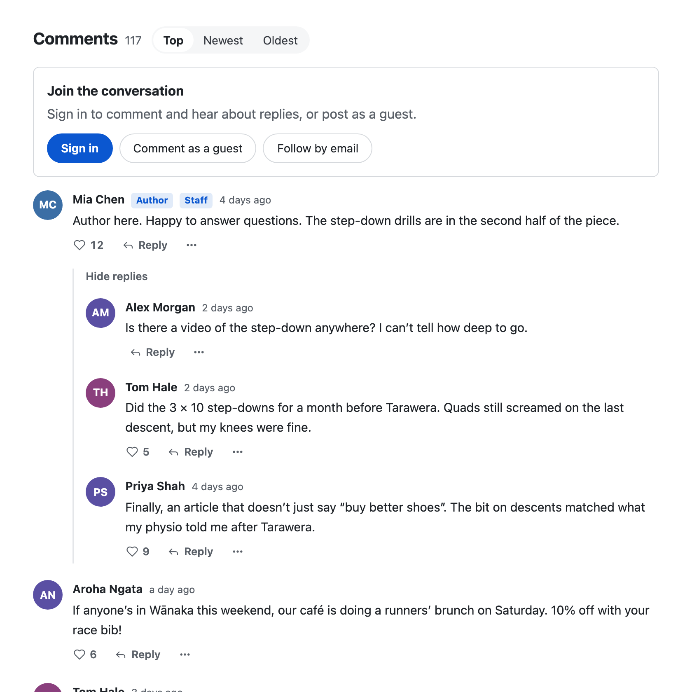

# Rendering Comments

Use `craft.comments.render()` in an element's Twig template to display its comments and a form for posting one. It's the only call a template needs, because it brings Comments' CSS and JavaScript with it. Put it in your entry template wherever the comments should appear:

```twig
{{ craft.comments.render(entry) }}
```

You can pass the element's ID instead, as `craft.comments.render(entry.id)`, which shows its comments on the current site.

The call outputs a small mount point and registers Comments' stylesheet and script. The mount point is a `<section>` holding a heading with the comment count and a line for visitors without JavaScript, and that's all the HTML Comments puts in your page. The `…` stands for the rest of the `<section>`'s `data-comments-*` attributes, which tell the script where to load the thread from and how to draw it:

```html
<section id="comments-109-1" class="comments comments--reserve-4" aria-labelledby="comments-109-1-heading" data-comments-root …>
    <h2 id="comments-109-1-heading" class="comments__heading">42 comments</h2>
    <noscript><p class="comments__noscript">Turn on JavaScript to read and post comments.</p></noscript>
</section>
```

Once the page has loaded, the script fetches the thread from Comments' data API as JSON and draws it in place, with buttons for choosing the sort order, the form, and threaded comments with their replies and controls. Which of these a visitor sees depends on your settings and whether they can comment. Signed-out visitors get a **Join the conversation** card with a way to sign in and, when guests can comment, a **Comment as a guest** button that opens the form. A closed discussion shows a notice in place of the form.

Nothing is output at all if the element doesn't exist, comments are turned off for it, or it isn't live, such as a disabled entry, an entry with a future post date or an unpublished draft. Otherwise the output is the same for every visitor, whether they're signed in or not, so a cached page never hides the thread from anyone, and the thread itself decides whether to offer them the form. Visitors without JavaScript see the heading and the line asking them to turn it on, which you can reword as described in [Text & Translations](docs:template-guides/text-translations), and [Choosing When Comments Load](#choosing-when-comments-load) covers what search engines see.



## `render()` Options

`render()` takes the element the comments belong to, or its ID, and an optional set of options for how they're rendered. When you pass an element, its own site is used unless the `siteId` option says otherwise. A draft or revision, such as the one Live Preview shows, displays the comments of the element it belongs to.

| Option | Type | Default | Description |
| --- | --- | --- | --- |
| `siteId` | `int` | The element's site, or the current site for an ID | Which site's version of the element to show comments for. |
| `sort` | `string` | The **Frontend Comment Order** setting | The initial order, which is `newest` (or `desc`), `oldest` (or `asc`), or `top`. |
| `limit` | `int` | `20` | How many top-level comments to show at first, and with each **Load more comments**, from 1 to 50. |
| `loadMode` | `string` | The **Load Comments** setting | When the comments load: `visible`, `button` or `eager`. See [Choosing When Comments Load](#choosing-when-comments-load). |
| `themeConfig` | `array` | The [`themeConfig`](docs:get-started/configuration#themeConfig) setting | Classes and attributes for the thread's buttons, inputs, links and avatars. See [Using Your Design System's Classes](docs:template-guides/theming#using-your-design-systems-classes). |
| `fields` | `array` | None | The names of custom elements that draw custom fields your own way, keyed by field handle, such as `{ rating: { input: 'star-input', display: 'star-rating' } }`. See [Drawing a Field Your Own Way](docs:template-guides/custom-fields#drawing-a-field-your-own-way). |
| `nonce` | `string` | None | A nonce from your Content Security Policy, added to the stylesheet and script tags and passed on to what the thread loads later, such as the Editor and spam protection challenges. |

For example, to show the ten oldest comments first:

```twig
{{ craft.comments.render(entry, { sort: 'oldest', limit: 10 }) }}
```

**Top** ranks comments by their votes, so it's only offered while **Interaction Mode** isn't set to **None**. Asking for `top` without interactions uses **Frontend Comment Order** instead.

Any other options are ignored, as is a second argument that isn't a set of options. To change how the thread looks, see [Theming](docs:template-guides/theming), or follow [Make a Custom Theme](docs:user-guides/make-a-custom-theme) to match it to your site step by step. For control over the CSS and JavaScript, see [Loading Comment Assets](docs:template-guides/loading-comment-assets). Most of what's shown is controlled by settings under **Comments** → **Settings**, which are explained in [Configuration](docs:get-started/configuration).

## Choosing When Comments Load

Comments at the bottom of a long article add work to every page view, even though many visitors never reach them. By default the script waits until a visitor scrolls within about 600 pixels of the mount point, then fetches the comments and draws them. Until then it shows a quiet loading line, and the rest of the thread's code waits too. When [rich authoring](docs:feature-tour/rich-authoring) is on, the Editor's files wait until someone starts writing.

**Load Comments**, under **Comments** → **Settings** → **CSS & JavaScript**, or the [`loadMode`](docs:get-started/configuration#loadMode) setting, chooses when that happens for the whole site.

| Load Comments | `loadMode` | What Visitors See |
| --- | --- | --- |
| When scrolled into view | `visible` | Comments load just before the visitor reaches them. This is the default. |
| When a button is pressed | `button` | A **Show comments** button with the count sits where the comments go, and they load when it's pressed. |
| With the page | `eager` | Comments load as soon as the page does, whether or not the visitor scrolls to them. |

Use the `loadMode` option for one page, which overrides the setting. A short discussion page could load its comments straight away, while a long-read template keeps them behind a button:

```twig
{{ craft.comments.render(entry, { loadMode: 'button' }) }}
```

In every mode the comments are drawn by the script, so their text isn't in the page's HTML. Search engines that run scripts see comments that load as they scroll into view or with the page, but not ones that wait for a button. To give crawlers that don't run scripts the comment text as well, add `craft.comments.structuredData()` to the same template, anywhere in the page:

```twig
{{ craft.comments.render(entry) }}
{{ craft.comments.structuredData(entry) }}
```

This outputs a `<script type="application/ld+json">` tag with the element's 20 newest approved comments as [schema.org](https://schema.org/Comment) JSON-LD, which crawlers read without running anything. Commenters' names are left out by default, and nothing about the visitor is included, so it's safe on a cached page. [Structured Data](docs:template-guides/structured-data) explains its options, such as including more comments or attaching them to the JSON-LD your SEO plugin outputs.

Comments load straight away whatever the mode when the page's URL links to [a comment](#linking-to-a-comment).

## Reserving Space for the Thread

So the page doesn't jump when the comments arrive, the mount point holds roughly the space the thread will take until it's drawn. Comments estimates it from the comment count, at about 6rem a comment up to 40rem, and gives the mount point one of five classes, from `comments--reserve-0` for a thread with no comments to `comments--reserve-4` for seven or more. The heights are in the bundled stylesheet rather than an inline style, so a strict Content Security Policy doesn't need to allow inline styles, and they apply with every theme, including **None**.

If your threads usually take more or less room than that, set `--comments-reserve` in your own CSS to use one height for every thread it reaches:

```css
.article-page [data-comments-root] {
    --comments-reserve: 24rem;
}
```

The reserved space is released once the thread is drawn. With **Load Bundled CSS** turned off, no space is reserved unless your own stylesheet does it.

## Caching Comments

The page never holds anything about the person viewing it, so a page with comments can be cached for everyone, whether that's with Craft's `` tag, a full-page cache such as Blitz, or a CDN. Who's signed in, their votes, what they can edit, the form's CSRF token and a moderator's held comments all arrive in the browser from a separate, private request, which is never cached.

```twig

    {{ craft.comments.render(entry) }}

```

Craft's cache tag keeps the asset bundles registered inside it, so the bundled CSS and JavaScript still load on a cached page.

The comments themselves come from the data API rather than the cached page, so comments posted after the page was cached still appear, and the heading's count is brought up to date when the thread is drawn. The data API's public responses can be cached too, which lets a CDN in front of your site serve the same comments to every visitor and keep a busy thread from reaching Craft on every view. A CDN holds them for a minute, and up to five more while it fetches a fresh copy, so a new comment can take that long to reach visitors who aren't the person who posted it.

Those responses are only cacheable when Craft's `@web` alias is defined in `config/general.php`. Without it, Craft works out your site's address from each request, and the data API marks its responses `private, no-cache` and skips Craft's data cache, so every view of a thread reaches Craft. [Setting `@web` So Reads Can Be Cached](docs:headless/data-api#setting-web-so-reads-can-be-cached) shows the setting and how to check it.

Check it works by viewing a cached page signed out, then again as a signed-in user. Each should get the form and controls they'd expect, and the page's source shouldn't contain a CSRF token or anything else about the person viewing it.

## Linking to a Comment

Every comment has an anchor of `#comment-123`, using its ID. Each comment's date links to it, and its **···** menu has **Copy link**. Links work wherever the comment is, whether that's past the first page, below a collapsed reply or deeper than replies are shown.

Opening a page with that hash loads the thread straight away, whatever the [load mode](#choosing-when-comments-load), finds the comment, or fetches its thread when it isn't among the comments shown first, then scrolls to it and highlights it. This works on a cached page too.

`comment.getPermalink()` gives you a full URL to the comment, ending with its anchor, as long as the element has a URL of its own:

```twig
<a href="{{ comment.getPermalink() }}">View comment</a>
```

Links in the default notification emails use the hash. A link to a comment that isn't public, or doesn't exist, lands on the page without highlighting anything.

## Using Comment Details Elsewhere

You'll sometimes want a little information about an element's discussion away from the comments themselves, such as a count on a listing page or a note that comments are closed. These calls each take the element itself rather than its ID.

`craft.comments.getSummary(element)` returns a summary of the element's discussion, or `null` if it doesn't have one yet, which is usually until its first comment. Its `commentCount` is the number of public comments, and `lastActivityAt` is when the discussion last changed. This shows a count beside each article in a news listing:

```twig

    

    <a href="{{ entry.url }}">{{ entry.title }}</a>
    <a href="{{ entry.url }}#comments-{{ entry.id }}-{{ entry.siteId }}">{{ summary.commentCount ?? 0 }} comments</a>

```

The second link jumps to the comments, because the outer element output by `render()` has an `id` of `comments-` followed by the element's ID and site ID.

`craft.comments.getConfig(element)` returns the settings that apply to the element's discussion, once the global settings and the element's Comments field have been taken into account. Its `enabled`, `closed` and `allowGuests` properties are true or false, while `moderationMode` and `sortOrder` hold values you can read with `.value`, such as `pre` and `newest`. `isCommentingEnabled()` is true when comments are turned on and not closed, before the visitor's permissions and **Auto-close Comments** are checked.

```twig



    <p>This discussion is closed to new comments.</p>

```

`craft.comments.isSubscribed(element)` returns whether the signed-in visitor follows the element's discussion, and always returns false for a guest. Pass a comment as the second argument to check whether they're following replies to that comment instead.

```twig

    <p>You're following this discussion.</p>

```

`craft.comments.getAvatar()` returns the signed-in visitor's photo as an asset, or otherwise the **Placeholder Avatar**, or an empty string if there's neither. It takes no arguments, and returns the placeholder for a guest. This shows the photo beside a link to the comments, such as in a page's header:

```twig



    

```

::: warning
`isSubscribed()` and `getAvatar()` answer for whoever is viewing the page, unlike `render()` and the other calls here. Keep them out of `` tags and pages a full-page cache or CDN serves to everyone, or the first visitor's answer is shown to everyone after them.
:::
