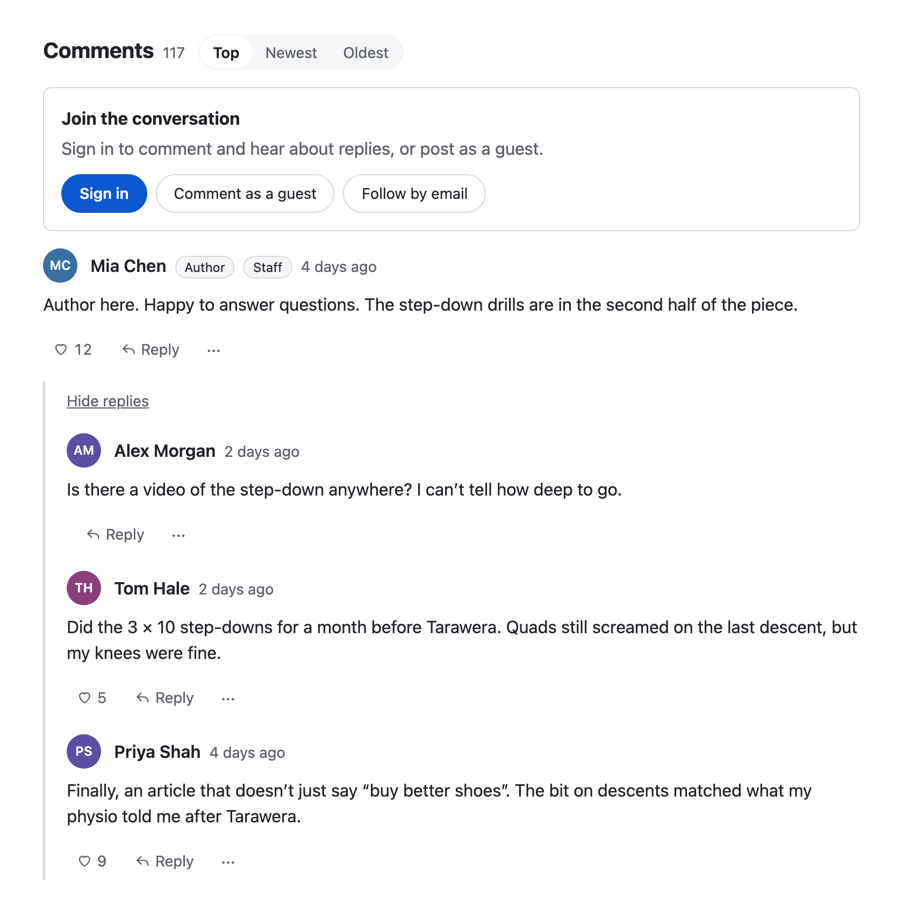
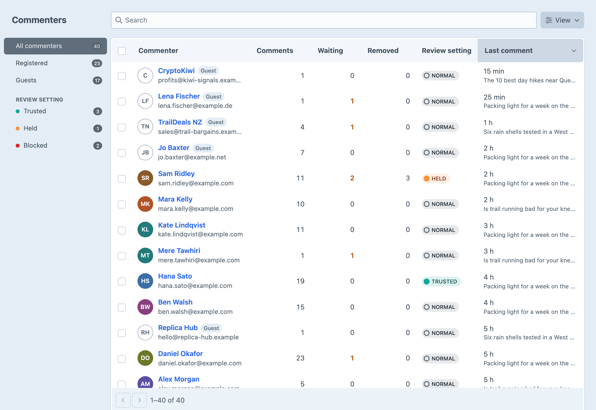
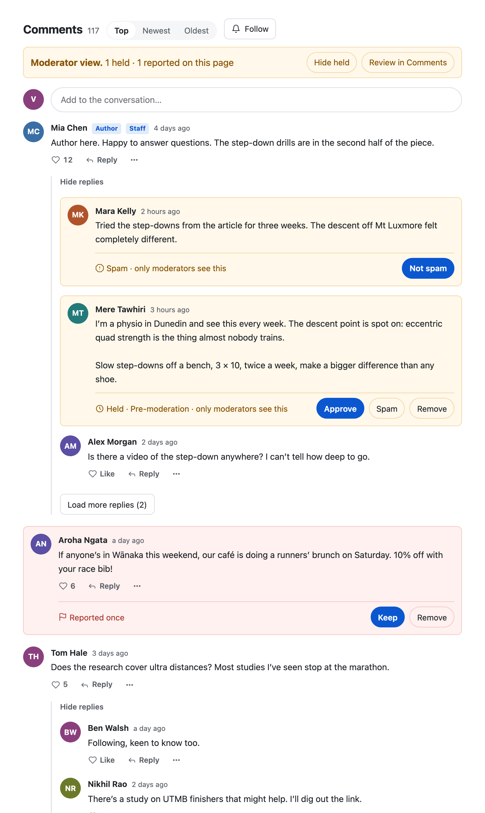

<!-- feature-intro -->
Take control of comments by keeping them alongside your Craft content. Comments gives your visitors a thoughtful place to talk and your moderators a calm place to look after it, all self-hosted, ad-free and shaped around your site.
<!-- feature-intro-end -->

<!-- feature-section media-size="medium" media-shadow="false" -->
## A complete discussion in one line of Twig

Render a styled, threaded discussion on any entry with a single line of Twig. Replies, likes or votes, author and staff badges, sorting and links to any comment are all included, in light and dark themes or one that follows your visitor's preference.

<!-- feature-section-end -->

<!-- feature-media media-shadow="false" -->
## Rich formatting, mentions and attachments

Commenters can format what they write, quote and share code, mention people in the discussion and attach images and files to a volume you choose. Drafts are kept in the browser, so a refreshed page doesn't cost anyone their reply.

Turn on GIFs and commenters can search GIPHY from the editor, or switch to plain text if you'd rather keep things short and simple. Mentions only suggest people connected to the discussion, so your user list stays private.

<!-- feature-media-end -->

<!-- feature-section -->
## Match the design of your site

Set a few CSS variables for your colours, fonts and corners, and hand your design system's button and form classes straight to Comments' controls. When the markup itself needs to change, replace only that part, such as the author line, a badge or the actions, and everything else keeps up to date with the plugin.
<!-- feature-section-end -->

<!-- feature-section media-size="large" -->
## Moderate in Craft

There's no separate dashboard to learn, because everything that needs a moderator waits in the Comments index under Needs review, Reported and Spam, with a count in the navigation so nothing sits unnoticed. Each comment says why it's there, and you can work through them one at a time or approve, remove or mark a handful as spam in one go.

<!-- feature-section-end -->

<!-- feature-media -->
## Review in context

Open a comment and the reason it's waiting sits right above it, with Approve, Spam and Remove beside it in the sidebar and Preview to see it in its thread on your site. Removing a comment asks for a reason, and an Activity tab keeps every report, decision and private moderator note, so the next person knows what happened.

<!-- feature-media-end -->

<!-- feature-media -->
## Know your commenters

Some people deserve the benefit of the doubt, and some have used it up. Commenters lists everyone who has joined in with their comment and report counts. Trusted commenters skip pre-moderation, held commenters always go to review, and blocked commenters can't post at all, with a note so the whole team knows why.

<!-- feature-media-end -->

<!-- feature-media copy-position="sticky" media-shadow="false" -->
## Moderate on the page

Sometimes it's quickest to read a comment where it lives. Moderators see held and reported comments in place on your site, tinted and labelled so they're never mistaken for what visitors see, and can approve, keep or remove them without opening the control panel. A moderator bar counts what's waiting and links straight to that entry's comments in Craft.

<!-- feature-media-end -->

<!-- feature-media -->
## Spam protection

Spam bots never meet a polite form they didn't like. Comments stops them with a honeypot, a minimum form time, single-use forms and rate limits before anything reaches your moderators, and adds Cloudflare Turnstile, reCAPTCHA v3 or Akismet when you want a second opinion.

Every comment it catches keeps what it found, so you can see why before deciding. Mark one as not spam and Akismet can learn from the correction.

<!-- feature-media-end -->

<!-- feature-grid -->
- :icon[thumb-up] **Likes or votes** Offer likes, or upvotes and downvotes, and let readers sort by the top comments.
- :icon[flag] **Report this comment** Visitors report a comment with reasons you choose, and it lands in your Reported list.
- :icon[mail] **Email notifications** Authors, commenters, followers and mentioned people are emailed about what's new, guests once they confirm their address, and every email has a one-click unsubscribe.
- :icon[bell] **Follow a discussion** Members and guests can follow a discussion to hear about every new comment.
- :icon[toggle-left] **Comments where you want them** Enable comments for entry sections, category groups, asset volumes or user groups, then open, close or turn them off for a single entry.
- :icon[filter] **Keyword filters** Hold, mark as spam or reject comments that match words or addresses you list.
- :icon[settings] **Settings for everything** Choose whether comments wait for approval, who moderates, whether guests can join in and how long authors can edit, in the control panel or your config file.
- :icon[bolt] **Works with full-page caching** The discussion loads as readers reach it, so Craft's cache tag, Blitz or a CDN can cache the page while each visitor still gets their own form and controls.
- :icon[brand-react] **React and Vue packages** Render the same thread in a React or Vue app, with your own components wherever you want them.
- :icon[api] **GraphQL, JSON and JavaScript** Query and post comments with GraphQL or the JSON data API, and hook into the browser with events and a JavaScript API.
- :icon[plug-connected] **Send notifications anywhere** Events let your site swap any email for its own delivery, or add Slack, an in-app inbox or anything else.
- :icon[search] **Found by search engines** Add your approved comments to the page as structured data, so crawlers that don't run scripts can read them too.
<!-- feature-grid-end -->
