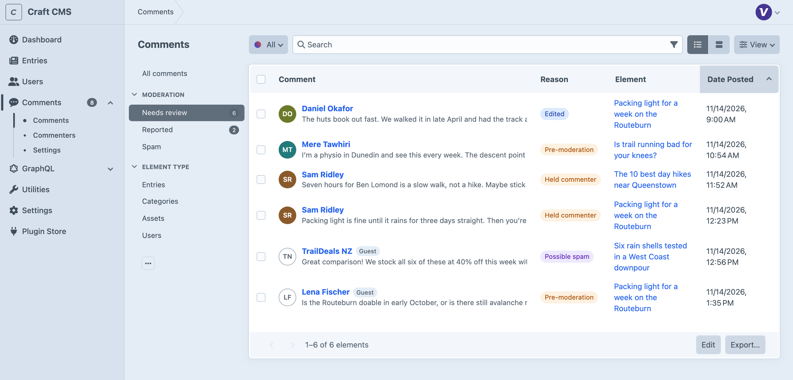
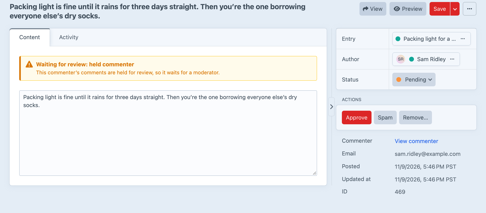
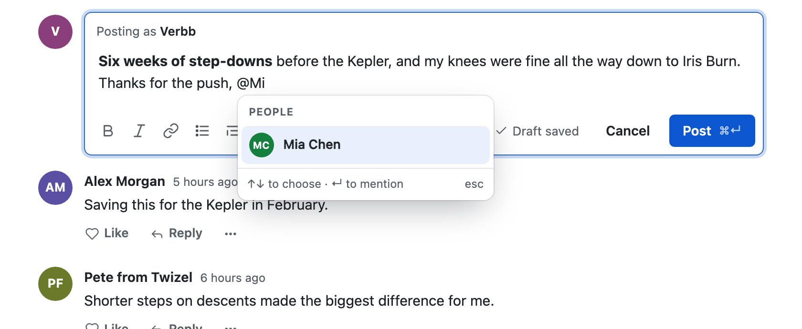
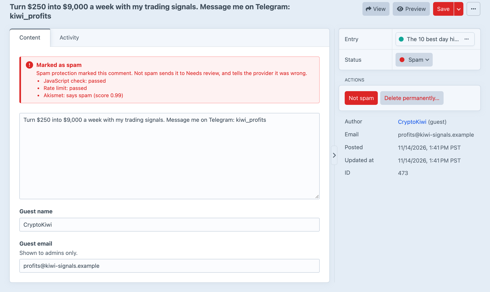

<!-- feature-intro -->
Take control of comments by keeping them alongside your Craft content. Comments gives your visitors a thoughtful place to talk and your moderators a calm place to look after it, all self-hosted, ad-free and shaped around your site.
<!-- feature-intro-end -->

<!-- feature-section media-size="large" -->
## Moderate in Craft

No separate dashboard to learn and no inbox to babysit. Everything that needs a moderator waits in the Comments index you already know, under **Needs review**, **Reported** and **Spam**, with a count in the navigation so nothing sits unnoticed.

Each comment says why it's there, whether that's pre-moderation, a held commenter, an edit to an approved comment or a spam check that wasn't sure. Work through the oldest first, or select a handful and approve, keep, remove or mark them as spam in one go.

<!-- feature-section-end -->

<!-- feature-media -->
## Review in context

Open a comment and the reason it's waiting is right at the top, with what it was reported for or what spam protection found. The decisions sit beside it in the sidebar (**Approve**, **Spam** and **Remove**, or **Keep** for a report you're happy to dismiss), and any edits you've made save in the same step.

Removing a comment asks for a reason and an optional private note, so the next moderator knows what happened. **Preview** shows the comment in its thread on your site before you decide.

<!-- feature-media-end -->

<!-- feature-media -->
## Every decision recorded

Each comment keeps its own history on an **Activity** tab, newest first. See when it was posted and edited, who reported it and why, who approved or removed it, and the notes moderators left for each other.

Notes post straight away without touching the comment, and only moderators ever see them. When someone asks why a comment came down, the answer is a click away.

<!-- feature-media-end -->

<!-- feature-media -->
## Know your commenters

Some people deserve the benefit of the doubt, and some have used it up. **Commenters** lists everyone who has joined in, with their counts of approved, waiting, removed and spam comments, and the reports made against them.

Give a regular the **Trusted** review setting and their comments skip pre-moderation, while spam checks still apply. **Held** sends everything someone posts to review, and **Blocked** stops them posting altogether, with a note and a history so the whole team knows why.

<!-- feature-media-end -->

<!-- feature-section media-size="medium" -->
## Choose where comments belong

Enable comments for the element groups that should host a conversation, from entry sections and category groups to asset volumes and user groups. Add the Comments field to a layout and editors can follow that setting or open, close or turn off comments for one particular entry.

The same field shows what's waiting on that entry, with buttons to approve, mark as spam, keep or remove each one in place, plus the latest comments and how many people follow along. Give it a tab of its own and it stays out of your writers' way.

<!-- feature-section-end -->

<!-- feature-media -->
## Moderate on the page

Sometimes it's quickest to read a comment where it lives. Moderators see held and reported comments in place on your site, tinted and labelled so they're never mistaken for what visitors see, and can approve, keep or remove them without opening the control panel.

A moderator bar counts what's waiting on the page, can hide held comments to show the page as visitors see it, and links straight to that entry's comments in Craft.

<!-- feature-media-end -->

<!-- feature-section media-size="medium" -->
## Ready-made or custom

Render a complete, styled discussion with one line of Twig. Threaded replies, likes or votes, author and staff badges, sorting and deep links to any comment are all there, in light, dark or automatic themes that follow your visitor's preference.

To match the rest of your site, set a few CSS variables for your colours, fonts and corners, reach for the stable class names for finer touches, and hand your design system's button and form classes straight to Comments' controls. When the markup itself needs to change, replace only that part, such as the author line, a badge or the actions, and keep everything else up to date with the plugin. For React and Vue apps, the companion packages draw the same thread, with your own components wherever you want them.

The page stays fast and fully cacheable, too. Comments only puts a light placeholder in your HTML and loads the discussion as readers reach it, and because nothing in the page depends on who's looking, Craft's `` tag, [Blitz](https://plugins.craftcms.com/blitz) or a CDN can serve it to everyone while each visitor still gets their own form and controls.

<!-- feature-section-end -->

<!-- feature-media -->
## Rich formatting, mentions and attachments

With rich authoring, commenters can format what they write, quote and share code, mention people in the discussion and attach images and files to a volume you choose. Drafts are kept in the browser, so a refreshed page doesn't cost anyone their reply.

Turn on GIFs and commenters can search GIPHY and add a GIF to any comment or reply, with rich or plain text. Mentions only suggest people connected to the discussion, so your user list stays private. Rich authoring is on for new installs, and the editor only loads once someone starts writing, so a page of comments stays light. If you'd rather keep things short and simple, switch to plain text and the same editor works without any formatting.

<!-- feature-media-end -->

<!-- feature-media -->
## Spam protection

Spam bots never meet a polite form they didn't like. Comments stops them with a honeypot, a minimum form time, single-use forms and rate limits before anything reaches your moderators, and adds Cloudflare Turnstile, reCAPTCHA v3 or Akismet when you want a second opinion.

Every comment it catches keeps what it found, so you can see why before deciding. Mark one as not spam and Akismet can learn from the correction.

<!-- feature-media-end -->

<!-- feature-media -->
## Settings for everything

Decide whether comments wait for approval or go up straight away, who your moderators are, whether guests can join in, and how long authors can edit what they wrote. Every setting can also live in your project's config file.

<!-- feature-media-end -->

<!-- feature-grid -->
- :icon[thumb-up] **Likes or votes** Offer likes, or upvotes and downvotes, and let readers sort by the top comments.
- :icon[flag] **Report this comment** Visitors report a comment with reasons you choose, and it lands in your Reported list.
- :icon[mail] **Email notifications** Authors, commenters, followers and mentioned people are emailed about what's new, guests once they confirm their address, and every email has a one-click unsubscribe.
- :icon[bell] **Follow a discussion** Members and guests can follow a discussion to hear about every new comment.
- :icon[plug-connected] **Send notifications anywhere** Events let your site swap any email for its own delivery, or add Slack, an in-app inbox or anything else.
- :icon[filter] **Keyword filters** Hold, mark as spam or reject comments that match words or addresses you list.
- :icon[api] **GraphQL, JSON and JavaScript** Query and post comments with GraphQL or the JSON data API, and hook into the browser with events and a JavaScript API.
- :icon[search] **Found by search engines** Add your approved comments to the page as structured data, so crawlers that don't run scripts can read them too.
<!-- feature-grid-end -->

<!-- feature-section -->
## Bring your comments with you

Upgrading from Comments 3 moves your comments, threads, votes, reports and subscriptions across in small batches that pick up where they left off if anything interrupts them. Before removing anything, the upgrade checks the new data against the old, and stops with your existing data in place if they don't match.
<!-- feature-section-end -->
